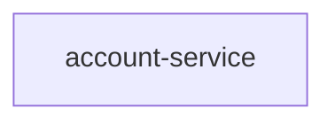
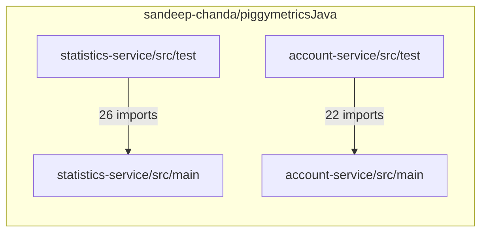

# Modernize PiggyMetricsJava account service to Microservices architecture

## Intent
Modernize the account service implementation in the PiggyMetricsJava application into microservices based architecture

## Summary
piggymetricsJava is 1 Maven module (account-service) · 22 Java files. 1 runtime service carries behaviour (account-service). The read states 4 HTTP endpoints, 1 stored collection, 2 outbound clients, 0 scheduled jobs, 0 OAuth clients and 14 tests in 5 classes. This is a modernization on account-service; every other Maven module stays as indexed.

## Services
- account-service · runtime · 4 endpoints · 1 collection · 2 clients · resource server · 14 tests

## Contract
- C1 · GET /{name} · server, or name == demo → Account · AccountController.getAccountByName · account-service/src/main/java/com/piggymetrics/account/controller/AccountController.java:L20
- C2 · GET /current · user → Account · AccountController.getCurrentAccount · account-service/src/main/java/com/piggymetrics/account/controller/AccountController.java:L25
- C3 · PUT /current · user · Account (validated) → void · AccountController.saveCurrentAccount · account-service/src/main/java/com/piggymetrics/account/controller/AccountController.java:L30
- C4 · POST / · open · User (validated) → Account · AccountController.createNewAccount · account-service/src/main/java/com/piggymetrics/account/controller/AccountController.java:L35

## Data
- accounts · Account · _id = name · name: String; lastSeen: Date; incomes: [Item{title, amount, currency, period, icon}] · @Valid; expenses: [Item{title, amount, currency, period, icon}] · @Valid; saving: Saving{amount, currency, interest, deposit, capitalization} · @Valid @NotNull; note: String · @Length(min = 0, max = 20_000) · account-service/src/main/java/com/piggymetrics/account/domain/Account.java:L13

## Edges
- E1 · account-service → auth-service · @FeignClient POST /uaa/users · none · propagates · account-service/src/main/java/com/piggymetrics/account/client/AuthServiceClient.java:L9
- E2 · account-service → statistics-service · @FeignClient PUT /statistics/{accountName} · none · fallback · StatisticsServiceClientFallback · account-service/src/main/java/com/piggymetrics/account/client/StatisticsServiceClient.java:L10
- E3 · account-service → config · spring.cloud.config.uri http://config:8888 · basic · fails to start · account-service/src/main/resources/bootstrap.yml:L6
- E4 · account-service → registry · @EnableDiscoveryClient · none · registers
- E5 · account-service → broker · spring-cloud-starter-bus-amqp, spring-cloud-netflix-hystrix-stream · none · metrics and bus only

## Non-functional requirements
- Today: account-service · `spring.cloud.config.fail-fast: true` — fails fast when the config server is unreachable · fail-fast on · account-service/src/main/resources/bootstrap.yml:L7
- Performance: no target stated
- Security: no target stated
- Availability: no target stated
- Observability: no target stated

## Impacted assets
- sandeep-chanda/piggymetricsJava · account-service/src/main/java/com/piggymetrics/account/AccountApplication.java
- sandeep-chanda/piggymetricsJava · account-service/src/main/resources/bootstrap.yml
- sandeep-chanda/piggymetricsJava · account-service/src/main/java/com/piggymetrics/account/client/AuthServiceClient.java
- sandeep-chanda/piggymetricsJava · account-service/src/main/java/com/piggymetrics/account/client/StatisticsServiceClient.java
- sandeep-chanda/piggymetricsJava · account-service/src/main/java/com/piggymetrics/account/controller/AccountController.java

## Code highlights
- account-service/src/main/java/com/piggymetrics/account/AccountApplication.java:L12 · @EnableDiscoveryClient
- account-service/src/main/java/com/piggymetrics/account/AccountApplication.java:L13 · @EnableOAuth2Client
- account-service/src/main/java/com/piggymetrics/account/AccountApplication.java:L14 · @EnableFeignClients
- account-service/src/main/java/com/piggymetrics/account/AccountApplication.java:L15 · @EnableCircuitBreaker
- account-service/src/main/java/com/piggymetrics/account/AccountApplication.java:L16 · @EnableGlobalMethodSecurity
- account-service/src/main/java/com/piggymetrics/account/client/AuthServiceClient.java:L9 · @FeignClient(name = "auth-service")
- account-service/src/main/java/com/piggymetrics/account/client/StatisticsServiceClient.java:L10 · @FeignClient(name = "statistics-service")
- account-service/src/main/java/com/piggymetrics/account/controller/AccountController.java:L20 · @RequestMapping(path = "/{name}", method = RequestMethod.GET)
- account-service/src/main/java/com/piggymetrics/account/controller/AccountController.java:L25 · @RequestMapping(path = "/current", method = RequestMethod.GET)
- account-service/src/main/java/com/piggymetrics/account/controller/AccountController.java:L30 · @RequestMapping(path = "/current", method = RequestMethod.PUT)
- account-service/src/main/java/com/piggymetrics/account/controller/AccountController.java:L35 · @RequestMapping(path = "/", method = RequestMethod.POST)

## Decisions
```decision
chosen: Eureka · retire · its successor | answered in the Brief · keeps: one way to do what Eureka does, its successor
chosen: Feign · retire · its successor | answered in the Brief · keeps: one way to do what Feign does, its successor
chosen: Spring Security OAuth · retire · its successor | answered in the Brief · keeps: one way to do what Spring Security OAuth does, its successor
chosen: Hystrix · retire · its successor | answered in the Brief · keeps: one way to do what Hystrix does, its successor
rejected: keep Eureka | nothing changes at its markers; the code keeps working as it does today | gives up its successor; Eureka's upkeep stays with this codebase
rejected: keep Feign | nothing changes at its markers; the code keeps working as it does today | gives up its successor; Feign's upkeep stays with this codebase
rejected: keep Spring Security OAuth | nothing changes at its markers; the code keeps working as it does today | gives up its successor; Spring Security OAuth's upkeep stays with this codebase
rejected: keep Hystrix | nothing changes at its markers; the code keeps working as it does today | gives up its successor; Hystrix's upkeep stays with this codebase
```

## Scope
- Limited to account-service in piggymetricsjava; the rest of the repository is out of scope.
- In: account-service · every endpoint (4), stored collection (1), outbound client (2) and scheduled job (0) the read states
- In: account-service — Eureka → ? · Feign → ? · Spring Security OAuth → ? · Hystrix → ?.
- Out: a destination or a rewrite — none; this is a modernization on piggymetricsJava.

## Acceptance criteria
- AC1 · Given the code as it stands today, when Phase 1 · Components is finished, then no retired framework is on the classpath and every kept test is green.

## Component map
- Eureka → the successor
- Replace @EnableDiscoveryClient · account-service/src/main/java/com/piggymetrics/account/AccountApplication.java:L12
- account-service · starter spring-cloud-starter-netflix-eureka-client → the successor · account-service/pom.xml
- Keep test StatisticsServiceClientFallbackTest green
- Feign → the successor
- Replace @EnableFeignClients · account-service/src/main/java/com/piggymetrics/account/AccountApplication.java:L14
- Replace @FeignClient · account-service/src/main/java/com/piggymetrics/account/client/AuthServiceClient.java:L9
- Replace @FeignClient · account-service/src/main/java/com/piggymetrics/account/client/StatisticsServiceClient.java:L10
- account-service · starter spring-cloud-starter-openfeign → the successor · account-service/pom.xml
- account-service · @EnableFeignClients → the successor · account-service/pom.xml
- Keep test StatisticsServiceClientFallbackTest green
- Spring Security OAuth → the successor
- Replace @EnableOAuth2Client · account-service/src/main/java/com/piggymetrics/account/AccountApplication.java:L13
- account-service · starter spring-cloud-starter-oauth2 → the successor · account-service/pom.xml
- Keep test StatisticsServiceClientFallbackTest green
- Hystrix → the successor
- Replace @EnableCircuitBreaker · account-service/src/main/java/com/piggymetrics/account/AccountApplication.java:L15
- account-service · starter spring-cloud-starter-netflix-hystrix → the successor · account-service/pom.xml
- account-service · starter spring-cloud-netflix-hystrix-stream → the successor · account-service/pom.xml
- Keep StatisticsServiceClientFallback as the fallback under the successor breaker · account-service/src/main/java/com/piggymetrics/account/client/StatisticsServiceClient.java
- Keep test StatisticsServiceClientFallbackTest green

## Architecture
**Module view**




**Module dependencies**



- 1 Maven module · 0 edges from the index · a modernization on account-service
- account-service · no resolved edges

## Phases
- Phase 1 · Components
  - Do: P1 · Eureka → the successor
  - Do: P2 · Feign → the successor
  - Do: P3 · Spring Security OAuth → the successor
  - Do: P4 · Hystrix → the successor
  - Done when: no retired framework is on the classpath and every kept test is green

## Guardrails
- Waived · quality_targets · We will consider the quality gates in second iteration of the code. · s.chanda@rebuildworks.ai

## Related work
- Modernize PiggyMetricsJava account service to Microservices architecture (draft) — spec already covering this

## Change plan
- Foundation — Do: define the account-service exposure gate as configuration scoped per service and environment, updating `account-service/pom.xml` and the root `pom.xml` only where build changes are required; Done when: the account service builds with the selected configuration model and its existing behavior remains available behind the disabled-by-default gate.
- Integration — Do: configure `gateway/pom.xml` and the configuration service represented by `config/pom.xml` so account-service exposure is controlled through the gateway; Done when: each environment can enable or disable exposure independently, while no unevidenced endpoint or client-failure behavior is assumed.
- Rollout — Do: update `docker-compose.dev.yml` and `docker-compose.yml`, then validate the Maven build through `.travis.yml`; Done when: local and deployed compositions start successfully in both gate states and CI passes before exposure is enabled.

## Plans
### P1 · Eureka → the successor
retire Eureka in place
- Done when: no Eureka marker, starter or config key remains; the successor is in its place; every test that names it stays green

1. Replace @EnableDiscoveryClient · account-service/src/main/java/com/piggymetrics/account/AccountApplication.java:L12
2. account-service · starter spring-cloud-starter-netflix-eureka-client → the successor · account-service/pom.xml
3. Keep test StatisticsServiceClientFallbackTest green

### P2 · Feign → the successor
retire Feign in place
- Done when: no Feign marker, starter or config key remains; the successor is in its place; every test that names it stays green

1. Replace @EnableFeignClients · account-service/src/main/java/com/piggymetrics/account/AccountApplication.java:L14
2. Replace @FeignClient · account-service/src/main/java/com/piggymetrics/account/client/AuthServiceClient.java:L9
3. Replace @FeignClient · account-service/src/main/java/com/piggymetrics/account/client/StatisticsServiceClient.java:L10
4. account-service · starter spring-cloud-starter-openfeign → the successor · account-service/pom.xml
5. account-service · @EnableFeignClients → the successor · account-service/pom.xml
6. Keep test StatisticsServiceClientFallbackTest green

### P3 · Spring Security OAuth → the successor
retire Spring Security OAuth in place
- Done when: no Spring Security OAuth marker, starter or config key remains; the successor is in its place; every test that names it stays green

1. Replace @EnableOAuth2Client · account-service/src/main/java/com/piggymetrics/account/AccountApplication.java:L13
2. account-service · starter spring-cloud-starter-oauth2 → the successor · account-service/pom.xml
3. Keep test StatisticsServiceClientFallbackTest green

### P4 · Hystrix → the successor
retire Hystrix in place
- Done when: no Hystrix marker, starter or config key remains; the successor is in its place; every test that names it stays green

1. Replace @EnableCircuitBreaker · account-service/src/main/java/com/piggymetrics/account/AccountApplication.java:L15
2. account-service · starter spring-cloud-starter-netflix-hystrix → the successor · account-service/pom.xml
3. account-service · starter spring-cloud-netflix-hystrix-stream → the successor · account-service/pom.xml
4. Keep StatisticsServiceClientFallback as the fallback under the successor breaker · account-service/src/main/java/com/piggymetrics/account/client/StatisticsServiceClient.java
5. Keep test StatisticsServiceClientFallbackTest green

## Todo
- [ ] Confirm scope and impacted assets
- [ ] Record the design — sandeep-chanda/piggymetricsJava has no architecture document indexed
- [ ] retire Eureka
- [ ] retire Feign
- [ ] retire Spring Security OAuth
- [ ] retire Hystrix

## Test plan
1. Tests that name a retired component stay green: StatisticsServiceClientFallbackTest green, StatisticsServiceClientFallbackTest green, StatisticsServiceClientFallbackTest green, StatisticsServiceClientFallbackTest green
2. After each component plan, the routes, stores and context paths the read states are unchanged

## Rollout
1. P1 · Eureka → the successor first; every module builds before a component moves
2. Then each retired component, in plan order: P2 · Feign → the successor, P3 · Spring Security OAuth → the successor, P4 · Hystrix → the successor
3. Routes, stores and context paths stay as the read states them

## Rollback
- Revert the platform pin and each component's files; the routes and stores are unchanged, so the data needs no rollback

## Risks
R1 · E1 · account-service calls auth-service outside the estate (POST /uaa/users); on failure the code propagates. The change keeps that behaviour or names the difference on its plan · account-service/src/main/java/com/piggymetrics/account/client/AuthServiceClient.java:L9
R2 · E2 · account-service calls statistics-service outside the estate (PUT /statistics/{accountName}); on failure the code fallback · StatisticsServiceClientFallback. The change keeps that behaviour or names the difference on its plan · account-service/src/main/java/com/piggymetrics/account/client/StatisticsServiceClient.java:L10
R3 · 1 module fail to start without the config server (account-service); every key they read moves into their own settings before that server is retired · account-service/src/main/resources/bootstrap.yml:L6
R4 · Account.lastSeen carries a time; a change that reformats it changes the stored accounts · account-service/src/main/java/com/piggymetrics/account/domain/Account.java:L13

## Estimate basis
total: 5.8977 usd
4 plans · $5.90 from tokencast for hm_harness. Human baseline 4 hours per task, one task per plan.
- P1 · $0.81 · tokencast · hm_harness · 2 files · low · tokencast list
- P2 · $2.36 · tokencast · hm_harness · 5 files · medium · tokencast list
- P3 · $0.81 · tokencast · hm_harness · 2 files · low · tokencast list
- P4 · $1.92 · tokencast · hm_harness · 4 files · medium · tokencast list

## Open questions
- Eureka · retire — successor ? · affects account-service · account-service/src/main/java/com/piggymetrics/account/AccountApplication.java:L12
- Feign · retire — successor ? · affects account-service · account-service/src/main/java/com/piggymetrics/account/AccountApplication.java:L14
- Spring Security OAuth · retire — successor ? · affects account-service · account-service/src/main/java/com/piggymetrics/account/AccountApplication.java:L13
- Hystrix · retire — successor ? · affects account-service · account-service/src/main/java/com/piggymetrics/account/AccountApplication.java:L15
- What performance target must the destination meet?
- What security target must the destination meet?
- What availability target must the destination meet?
- What observability target must the destination meet?

## Citations
[^1]: sandeep-chanda/piggymetricsJava · account-service/src/main/java/com/piggymetrics/account/AccountApplication.java:L11
[^2]: sandeep-chanda/piggymetricsJava · account-service/src/main/java/com/piggymetrics/account/AccountApplication.java:L11
[^3]: sandeep-chanda/piggymetricsJava · account-service/src/main/java/com/piggymetrics/account/AccountApplication.java:L11
[^4]: sandeep-chanda/piggymetricsJava · account-service/src/main/java/com/piggymetrics/account/AccountApplication.java:L12
[^5]: sandeep-chanda/piggymetricsJava · account-service/src/main/java/com/piggymetrics/account/AccountApplication.java:L14
[^6]: sandeep-chanda/piggymetricsJava · account-service/src/main/java/com/piggymetrics/account/client/AuthServiceClient.java:L9
[^7]: sandeep-chanda/piggymetricsJava · account-service/src/main/java/com/piggymetrics/account/client/StatisticsServiceClient.java:L10
[^8]: sandeep-chanda/piggymetricsJava · account-service/src/main/java/com/piggymetrics/account/AccountApplication.java:L13
[^9]: sandeep-chanda/piggymetricsJava · account-service/src/main/java/com/piggymetrics/account/AccountApplication.java:L15
[^10]: sandeep-chanda/piggymetricsJava · account-service/src/main/java/com/piggymetrics/account/AccountApplication.java:L11
[^11]: sandeep-chanda/piggymetricsJava · account-service/src/main/resources/bootstrap.yml:L6
[^12]: sandeep-chanda/piggymetricsJava · account-service/src/main/java/com/piggymetrics/account/client/AuthServiceClient.java:L9
[^13]: sandeep-chanda/piggymetricsJava · account-service/src/main/java/com/piggymetrics/account/client/StatisticsServiceClient.java:L10
[^14]: sandeep-chanda/piggymetricsJava · account-service/src/main/java/com/piggymetrics/account/controller/AccountController.java:L20
[^15]: sandeep-chanda/piggymetricsJava · account-service/src/main/java/com/piggymetrics/account/AccountApplication.java:L12
[^16]: sandeep-chanda/piggymetricsJava · account-service/src/main/java/com/piggymetrics/account/AccountApplication.java:L13
[^17]: sandeep-chanda/piggymetricsJava · account-service/src/main/java/com/piggymetrics/account/AccountApplication.java:L14
[^18]: sandeep-chanda/piggymetricsJava · account-service/src/main/java/com/piggymetrics/account/AccountApplication.java:L15
[^19]: sandeep-chanda/piggymetricsJava · account-service/src/main/java/com/piggymetrics/account/AccountApplication.java:L16
[^20]: sandeep-chanda/piggymetricsJava · account-service/src/main/java/com/piggymetrics/account/client/AuthServiceClient.java:L9
[^21]: sandeep-chanda/piggymetricsJava · account-service/src/main/java/com/piggymetrics/account/client/StatisticsServiceClient.java:L10
[^22]: sandeep-chanda/piggymetricsJava · account-service/src/main/java/com/piggymetrics/account/controller/AccountController.java:L20
[^23]: sandeep-chanda/piggymetricsJava · account-service/src/main/java/com/piggymetrics/account/controller/AccountController.java:L25
[^24]: sandeep-chanda/piggymetricsJava · account-service/src/main/java/com/piggymetrics/account/controller/AccountController.java:L30
[^25]: sandeep-chanda/piggymetricsJava · account-service/src/main/java/com/piggymetrics/account/controller/AccountController.java:L35
[^26]: sandeep-chanda/piggymetricsJava · account-service/src/main/java/com/piggymetrics/account/AccountApplication.java:L12
[^27]: sandeep-chanda/piggymetricsJava · account-service/src/main/java/com/piggymetrics/account/AccountApplication.java:L14
[^28]: sandeep-chanda/piggymetricsJava · account-service/src/main/java/com/piggymetrics/account/client/AuthServiceClient.java:L9
[^29]: sandeep-chanda/piggymetricsJava · account-service/src/main/java/com/piggymetrics/account/client/StatisticsServiceClient.java:L10
[^30]: sandeep-chanda/piggymetricsJava · account-service/src/main/java/com/piggymetrics/account/AccountApplication.java:L13
[^31]: sandeep-chanda/piggymetricsJava · account-service/src/main/java/com/piggymetrics/account/AccountApplication.java:L15
[^32]: sandeep-chanda/piggymetricsJava · account-service/src/main/java/com/piggymetrics/account/domain/Account.java:L13-82
[^33]: sandeep-chanda/piggymetricsJava · README.md
[^34]: sandeep-chanda/piggymetricsJava · .harnessmatters/README.md
[^35]: sandeep-chanda/piggymetricsJava · account-service/pom.xml
[^36]: sandeep-chanda/piggymetricsJava · auth-service/pom.xml
[^37]: sandeep-chanda/piggymetricsJava · pom.xml
[^38]: sandeep-chanda/piggymetricsJava · .travis.yml
[^39]: sandeep-chanda/piggymetricsJava · config/pom.xml
[^40]: sandeep-chanda/piggymetricsJava · docker-compose.dev.yml
[^41]: sandeep-chanda/piggymetricsJava · docker-compose.yml
[^42]: sandeep-chanda/piggymetricsJava · gateway/pom.xml
[^43]: sandeep-chanda/piggymetricsJava · monitoring/pom.xml
[^44]: sandeep-chanda/piggymetricsJava · notification-service/pom.xml
[^45]: adr_01
[^46]: sandeep-chanda/piggymetricsJava · account-service/src/main/resources/bootstrap.yml:L7
[^47]: sandeep-chanda/piggymetricsJava · account-service/src/main/java/com/piggymetrics/account/controller/AccountController.java:L20
[^48]: sandeep-chanda/piggymetricsJava · account-service/src/main/java/com/piggymetrics/account/domain/Account.java:L13
[^49]: sandeep-chanda/piggymetricsJava · account-service/src/main/java/com/piggymetrics/account/client/AuthServiceClient.java:L9
[^50]: sandeep-chanda/piggymetricsJava · account-service/src/main/java/com/piggymetrics/account/controller/AccountController.java:L20
[^51]: sandeep-chanda/piggymetricsJava · account-service/src/main/java/com/piggymetrics/account/controller/AccountController.java:L25
[^52]: sandeep-chanda/piggymetricsJava · account-service/src/main/java/com/piggymetrics/account/controller/AccountController.java:L30
[^53]: sandeep-chanda/piggymetricsJava · account-service/src/main/java/com/piggymetrics/account/controller/AccountController.java:L35
[^54]: sandeep-chanda/piggymetricsJava · account-service/src/main/java/com/piggymetrics/account/domain/Account.java:L13
[^55]: sandeep-chanda/piggymetricsJava · account-service/src/main/java/com/piggymetrics/account/client/AuthServiceClient.java:L9
[^56]: sandeep-chanda/piggymetricsJava · account-service/src/main/java/com/piggymetrics/account/client/StatisticsServiceClient.java:L10
[^57]: sandeep-chanda/piggymetricsJava · account-service/src/main/resources/bootstrap.yml:L6
[^58]: sandeep-chanda/piggymetricsJava · account-service/src/main/java/com/piggymetrics/account/client/AuthServiceClient.java:L9
[^59]: sandeep-chanda/piggymetricsJava · account-service/src/main/java/com/piggymetrics/account/client/StatisticsServiceClient.java:L10
[^60]: sandeep-chanda/piggymetricsJava · account-service/src/main/resources/bootstrap.yml:L6
[^61]: sandeep-chanda/piggymetricsJava · account-service/src/main/java/com/piggymetrics/account/domain/Account.java:L13
[^62]: spec:df3c75a5-3de1-49c5-ac5c-395377592c22

## Success criteria
- Regression: 14 of 14 ported tests pass
