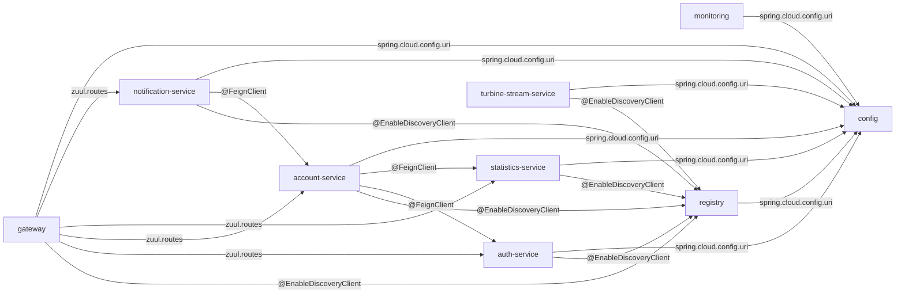
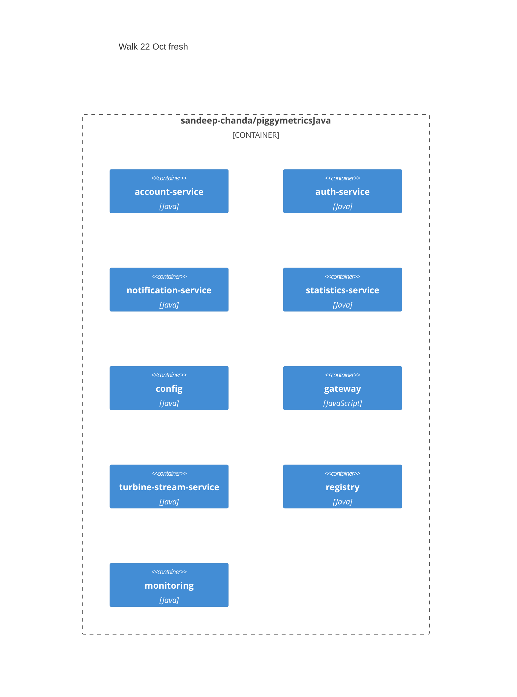
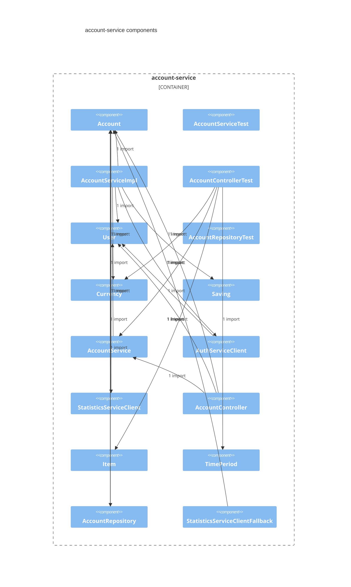
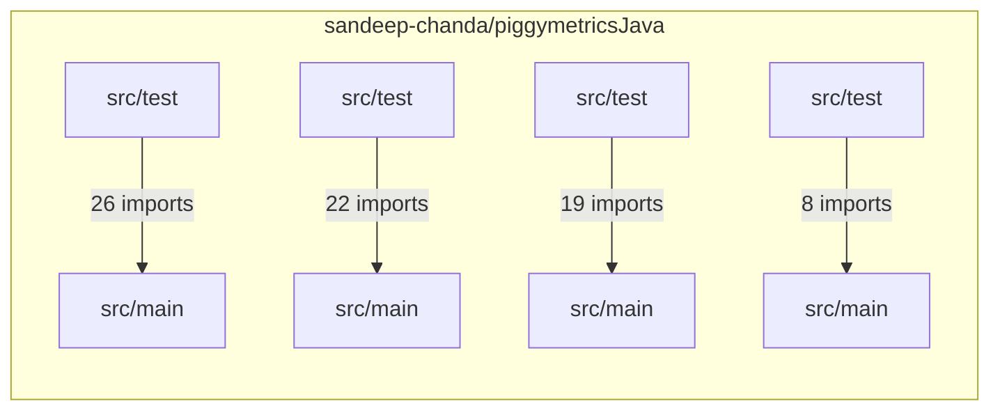

# Walk 22 Oct fresh

## Intent
Upgrade piggymetricsJava in place to Spring Boot 3 and Java 21. Keep the same repo.

## Summary
piggymetricsJava is 9 Maven modules (account-service, auth-service, config, gateway, monitoring, notification-service, registry, statistics-service, turbine-stream-service) · 97 Java files on spring-boot-starter-parent 2.0.3.RELEASE · Java 1.8. 5 runtime services carry behaviour (gateway, auth-service, account-service, statistics-service, notification-service); 4 infrastructure modules exist for the platform (config (config-server), monitoring (dashboard), registry (registry), turbine-stream-service (metrics-stream)) and become platform decisions, not units. The read states 12 HTTP endpoints, 4 stored collections, 4 outbound clients, 2 scheduled jobs, 4 OAuth clients and 61 tests in 25 classes. This is a modernization on account-service, gateway, notification-service, statistics-service, config; every other Maven module stays as indexed.

## Services
- config · infrastructure · config-server · port 8888 · no tests
- monitoring · infrastructure · dashboard · 1 test
- registry · infrastructure · registry · port 8761 · no tests
- gateway · runtime · gateway · port 4000 · 2 tests
- auth-service · runtime · port 5000 · /uaa · users on auth-mongodb · 3 endpoints · 1 collection · authorization server · 9 tests
- account-service · runtime · port 6000 · /accounts · accounts on account-mongodb · 4 endpoints · 1 collection · 2 clients · resource server · 14 tests
- statistics-service · runtime · port 7000 · /statistics · datapoints on statistics-mongodb · 3 endpoints · 1 collection · 1 client · resource server · 16 tests
- notification-service · runtime · port 8000 · /notifications · recipients on notification-mongodb · 2 endpoints · 1 collection · 1 client · 2 jobs · resource server · 18 tests
- turbine-stream-service · infrastructure · metrics-stream · 1 test

## Contract
- C1 · GET /uaa/users/current · user → Principal · UserController.getUser · auth-service/src/main/java/com/piggymetrics/auth/controller/UserController.java:L22
- C2 · POST /uaa/users · server · User (validated) → void · UserController.createUser · auth-service/src/main/java/com/piggymetrics/auth/controller/UserController.java:L28
- C3 · POST /uaa/oauth/token · client basic auth · grant_type=client_credentials | password | refresh_token → token · framework · TokenEndpoint
- C4 · GET /accounts/{name} · server, or name == demo → Account · AccountController.getAccountByName · account-service/src/main/java/com/piggymetrics/account/controller/AccountController.java:L20
- C5 · GET /accounts/current · user → Account · AccountController.getCurrentAccount · account-service/src/main/java/com/piggymetrics/account/controller/AccountController.java:L25
- C6 · PUT /accounts/current · user · Account (validated) → void · AccountController.saveCurrentAccount · account-service/src/main/java/com/piggymetrics/account/controller/AccountController.java:L30
- C7 · POST /accounts · open · User (validated) → Account · AccountController.createNewAccount · account-service/src/main/java/com/piggymetrics/account/controller/AccountController.java:L35
- C8 · GET /statistics/current · user → List<DataPoint> · StatisticsController.getCurrentAccountStatistics · statistics-service/src/main/java/com/piggymetrics/statistics/controller/StatisticsController.java:L20
- C9 · GET /statistics/{accountName} · server, or accountName == demo → List<DataPoint> · StatisticsController.getStatisticsByAccountName · statistics-service/src/main/java/com/piggymetrics/statistics/controller/StatisticsController.java:L26
- C10 · PUT /statistics/{accountName} · server · Account (validated) → void · StatisticsController.saveAccountStatistics · statistics-service/src/main/java/com/piggymetrics/statistics/controller/StatisticsController.java:L32
- C11 · GET /notifications/recipients/current · user → Object · RecipientController.getCurrentNotificationsSettings · notification-service/src/main/java/com/piggymetrics/notification/controller/RecipientController.java:L21
- C12 · PUT /notifications/recipients/current · user · Recipient (validated) → Object · RecipientController.saveCurrentNotificationsSettings · notification-service/src/main/java/com/piggymetrics/notification/controller/RecipientController.java:L26

## Data
- users on auth-mongodb · User · _id = username · username: String; password: String · auth-service/src/main/java/com/piggymetrics/auth/domain/User.java:L10
- accounts on account-mongodb · Account · _id = name · name: String; lastSeen: Date; incomes: [Item{title, amount, currency, period, icon}] · @Valid; expenses: [Item{title, amount, currency, period, icon}] · @Valid; saving: Saving{amount, currency, interest, deposit, capitalization} · @Valid @NotNull; note: String · @Length(min = 0, max = 20_000) · account-service/src/main/java/com/piggymetrics/account/domain/Account.java:L13
- accounts · request shape, no repository saves it · Account · incomes: [Item{title, amount, currency, period}] · @Valid @NotNull; expenses: [Item{title, amount, currency, period}] · @Valid @NotNull; saving: Saving{amount, currency, interest, deposit, capitalization} · @Valid @NotNull · statistics-service/src/main/java/com/piggymetrics/statistics/domain/Account.java:L10
- datapoints on statistics-mongodb · DataPoint · _id = id · id: DataPointId{serialVersionUID, account, date}; incomes: [ItemMetric{title, amount}]; expenses: [ItemMetric{title, amount}]; statistics: Map<StatisticMetric, BigDecimal>; rates: Map<Currency, BigDecimal> · statistics-service/src/main/java/com/piggymetrics/statistics/domain/timeseries/DataPoint.java:L15
- recipients on notification-mongodb · Recipient · _id = accountName · accountName: String; email: String · @NotNull @Email; scheduledNotifications: NotificationSettings{active, frequency, lastNotified} · @Valid · notification-service/src/main/java/com/piggymetrics/notification/domain/Recipient.java:L11

## Edges
- E1 · account-service → auth-service · @FeignClient POST /uaa/users · server · propagates · account-service/src/main/java/com/piggymetrics/account/client/AuthServiceClient.java:L9
- E2 · account-service → statistics-service · @FeignClient PUT /statistics/{accountName} · server · fallback · StatisticsServiceClientFallback · account-service/src/main/java/com/piggymetrics/account/client/StatisticsServiceClient.java:L10
- E3 · statistics-service → ${rates.url} · @FeignClient GET /latest · none · fallback · ExchangeRatesClientFallback · statistics-service/src/main/java/com/piggymetrics/statistics/client/ExchangeRatesClient.java:L10
- E4 · notification-service → account-service · @FeignClient GET /accounts/{accountName} · server · caught and logged in NotificationServiceImpl · notification-service/src/main/java/com/piggymetrics/notification/client/AccountServiceClient.java:L9
- E5 · monitoring → config · spring.cloud.config.uri http://config:8888 · basic · fails to start · monitoring/src/main/resources/bootstrap.yml:L6
- E6 · registry → config · spring.cloud.config.uri http://config:8888 · basic · fails to start · registry/src/main/resources/bootstrap.yml:L6
- E7 · gateway → auth-service · zuul.routes /uaa/** · pass-through · by url · config/src/main/resources/shared/gateway.yml:L21
- E8 · gateway → account-service · zuul.routes /accounts/** · pass-through · by serviceId · config/src/main/resources/shared/gateway.yml:L27
- E9 · gateway → statistics-service · zuul.routes /statistics/** · pass-through · by serviceId · config/src/main/resources/shared/gateway.yml:L33
- E10 · gateway → notification-service · zuul.routes /notifications/** · pass-through · by serviceId · config/src/main/resources/shared/gateway.yml:L39
- E11 · gateway → config · spring.cloud.config.uri http://config:8888 · basic · fails to start · gateway/src/main/resources/bootstrap.yml:L6
- E12 · gateway → registry · @EnableDiscoveryClient · none · registers
- E13 · auth-service → config · spring.cloud.config.uri http://config:8888 · basic · fails to start · auth-service/src/main/resources/bootstrap.yml:L6
- E14 · auth-service → registry · @EnableDiscoveryClient · none · registers
- E15 · account-service → config · spring.cloud.config.uri http://config:8888 · basic · fails to start · account-service/src/main/resources/bootstrap.yml:L6
- E16 · account-service → registry · @EnableDiscoveryClient · none · registers
- E17 · account-service → broker · spring-cloud-starter-bus-amqp, spring-cloud-netflix-hystrix-stream rabbitmq · none · metrics and bus only · config/src/main/resources/shared/application.yml:L27
- E18 · account-service → auth · user-info-uri http://auth-service:5000/uaa/users/current · bearer · invalid token → 401 · config/src/main/resources/shared/application.yml:L23
- E19 · statistics-service → config · spring.cloud.config.uri http://config:8888 · basic · fails to start · statistics-service/src/main/resources/bootstrap.yml:L6
- E20 · statistics-service → registry · @EnableDiscoveryClient · none · registers
- E21 · statistics-service → broker · spring-cloud-starter-bus-amqp, spring-cloud-netflix-hystrix-stream rabbitmq · none · metrics and bus only · config/src/main/resources/shared/application.yml:L27
- E22 · statistics-service → auth · user-info-uri http://auth-service:5000/uaa/users/current · bearer · invalid token → 401 · config/src/main/resources/shared/application.yml:L23
- E23 · notification-service → config · spring.cloud.config.uri http://config:8888 · basic · fails to start · notification-service/src/main/resources/bootstrap.yml:L6
- E24 · notification-service → registry · @EnableDiscoveryClient · none · registers
- E25 · notification-service → broker · spring-cloud-starter-bus-amqp, spring-cloud-netflix-hystrix-stream rabbitmq · none · metrics and bus only · config/src/main/resources/shared/application.yml:L27
- E26 · notification-service → auth · user-info-uri http://auth-service:5000/uaa/users/current · bearer · invalid token → 401 · config/src/main/resources/shared/application.yml:L23
- E27 · turbine-stream-service → config · spring.cloud.config.uri http://config:8888 · basic · fails to start · turbine-stream-service/src/main/resources/bootstrap.yml:L6
- E28 · turbine-stream-service → registry · @EnableDiscoveryClient · none · registers
- E29 · turbine-stream-service → broker · spring-cloud-starter-netflix-turbine-stream, spring-cloud-starter-stream-rabbit rabbitmq · none · metrics and bus only · config/src/main/resources/shared/application.yml:L27

## Non-functional requirements
- account-service · `spring.cloud.config.fail-fast: true` — fails fast when the config server is unreachable · fail-fast on · account-service/src/main/resources/bootstrap.yml:L7
- auth-service · `spring.cloud.config.fail-fast: true` — fails fast when the config server is unreachable · fail-fast on · auth-service/src/main/resources/bootstrap.yml:L7
- account-service · `spring.data.mongodb.host: account-mongodb` — the service's own store · config/src/main/resources/shared/account-service.yml:L13
- account-service · `feign.hystrix.enabled: true` — circuit breaker · config/src/main/resources/shared/account-service.yml:L26
- every service · `hystrix.command.default.execution.isolation.thread.timeoutInMilliseconds: 10000` — 10 s timeout · config/src/main/resources/shared/application.yml:L11
- every service · `spring.rabbitmq.host: rabbitmq` — message broker · config/src/main/resources/shared/application.yml:L27
- auth-service · `spring.data.mongodb.host: auth-mongodb` — the service's own store · config/src/main/resources/shared/auth-service.yml:L4
- gateway · `hystrix.command.default.execution.isolation.thread.timeoutInMilliseconds: 20000` — 20 s timeout · config/src/main/resources/shared/gateway.yml:L7
- gateway · `ribbon.ReadTimeout: 20000` — 20 s timeout · config/src/main/resources/shared/gateway.yml:L10
- gateway · `ribbon.ConnectTimeout: 20000` — 20 s timeout · config/src/main/resources/shared/gateway.yml:L11
- gateway · `zuul.host.connect-timeout-millis: 20000` — 20 s timeout · config/src/main/resources/shared/gateway.yml:L16
- gateway · `zuul.host.socket-timeout-millis: 20000` — 20 s timeout · config/src/main/resources/shared/gateway.yml:L17
- notification-service · `spring.data.mongodb.host: notification-mongodb` — the service's own store · config/src/main/resources/shared/notification-service.yml:L31
- statistics-service · `spring.data.mongodb.host: statistics-mongodb` — the service's own store · config/src/main/resources/shared/statistics-service.yml:L13
- gateway · `spring.cloud.config.fail-fast: true` — fails fast when the config server is unreachable · fail-fast on · gateway/src/main/resources/bootstrap.yml:L7
- monitoring · `spring.cloud.config.fail-fast: true` — fails fast when the config server is unreachable · fail-fast on · monitoring/src/main/resources/bootstrap.yml:L7
- notification-service · `spring.cloud.config.fail-fast: true` — fails fast when the config server is unreachable · fail-fast on · notification-service/src/main/resources/bootstrap.yml:L7
- registry · `spring.cloud.config.fail-fast: true` — fails fast when the config server is unreachable · fail-fast on · registry/src/main/resources/bootstrap.yml:L7
- statistics-service · `spring.cloud.config.fail-fast: true` — fails fast when the config server is unreachable · fail-fast on · statistics-service/src/main/resources/bootstrap.yml:L7
- turbine-stream-service · `spring.cloud.config.fail-fast: true` — fails fast when the config server is unreachable · fail-fast on · turbine-stream-service/src/main/resources/bootstrap.yml:L7
- one store per service — 4 modules carry 4 distinct datasource hosts: account-service → account-mongodb, auth-service → auth-mongodb, notification-service → notification-mongodb, statistics-service → statistics-mongodb · config/src/main/resources/shared/account-service.yml:L13 · config/src/main/resources/shared/auth-service.yml:L4 · config/src/main/resources/shared/notification-service.yml:L31 · config/src/main/resources/shared/statistics-service.yml:L13

## Impacted assets
- sandeep-chanda/piggymetricsJava · account-service/src/main/java/com/piggymetrics/account/AccountApplication.java
- sandeep-chanda/piggymetricsJava · gateway/src/main/java/com/piggymetrics/gateway/GatewayApplication.java
- sandeep-chanda/piggymetricsJava · notification-service/src/main/java/com/piggymetrics/notification/NotificationServiceApplication.java
- sandeep-chanda/piggymetricsJava · statistics-service/src/main/java/com/piggymetrics/statistics/StatisticsApplication.java
- sandeep-chanda/piggymetricsJava · config/src/main/java/com/piggymetrics/config/ConfigApplication.java
- sandeep-chanda/piggymetricsJava · account-service/src/main/resources/bootstrap.yml
- sandeep-chanda/piggymetricsJava · config/src/main/resources/shared/account-service.yml
- sandeep-chanda/piggymetricsJava · config/src/main/resources/shared/application.yml
- sandeep-chanda/piggymetricsJava · config/src/main/resources/shared/auth-service.yml
- sandeep-chanda/piggymetricsJava · config/src/main/resources/shared/gateway.yml
- sandeep-chanda/piggymetricsJava · config/src/main/resources/shared/notification-service.yml
- sandeep-chanda/piggymetricsJava · config/src/main/resources/shared/registry.yml
- sandeep-chanda/piggymetricsJava · config/src/main/resources/shared/statistics-service.yml
- sandeep-chanda/piggymetricsJava · gateway/src/main/resources/bootstrap.yml
- sandeep-chanda/piggymetricsJava · notification-service/src/main/resources/bootstrap.yml
- sandeep-chanda/piggymetricsJava · statistics-service/src/main/resources/bootstrap.yml
- sandeep-chanda/piggymetricsJava · account-service/src/main/java/com/piggymetrics/account/client/AuthServiceClient.java
- sandeep-chanda/piggymetricsJava · account-service/src/main/java/com/piggymetrics/account/client/StatisticsServiceClient.java
- sandeep-chanda/piggymetricsJava · notification-service/src/main/java/com/piggymetrics/notification/client/AccountServiceClient.java
- sandeep-chanda/piggymetricsJava · statistics-service/src/main/java/com/piggymetrics/statistics/client/ExchangeRatesClient.java
- sandeep-chanda/piggymetricsJava · account-service/src/main/java/com/piggymetrics/account/controller/AccountController.java
- sandeep-chanda/piggymetricsJava · notification-service/src/main/java/com/piggymetrics/notification/controller/RecipientController.java
- sandeep-chanda/piggymetricsJava · statistics-service/src/main/java/com/piggymetrics/statistics/controller/StatisticsController.java

## Code highlights
- account-service/src/main/java/com/piggymetrics/account/AccountApplication.java:L12 · @EnableDiscoveryClient
- account-service/src/main/java/com/piggymetrics/account/AccountApplication.java:L13 · @EnableOAuth2Client
- account-service/src/main/java/com/piggymetrics/account/AccountApplication.java:L14 · @EnableFeignClients
- account-service/src/main/java/com/piggymetrics/account/AccountApplication.java:L15 · @EnableCircuitBreaker
- account-service/src/main/java/com/piggymetrics/account/AccountApplication.java:L16 · @EnableGlobalMethodSecurity
- config/src/main/java/com/piggymetrics/config/ConfigApplication.java:L8 · @EnableConfigServer
- gateway/src/main/java/com/piggymetrics/gateway/GatewayApplication.java:L9 · @EnableDiscoveryClient
- gateway/src/main/java/com/piggymetrics/gateway/GatewayApplication.java:L10 · @EnableZuulProxy
- notification-service/src/main/java/com/piggymetrics/notification/NotificationServiceApplication.java:L19 · @EnableDiscoveryClient
- notification-service/src/main/java/com/piggymetrics/notification/NotificationServiceApplication.java:L20 · @EnableOAuth2Client
- notification-service/src/main/java/com/piggymetrics/notification/NotificationServiceApplication.java:L21 · @EnableFeignClients
- notification-service/src/main/java/com/piggymetrics/notification/NotificationServiceApplication.java:L22 · @EnableGlobalMethodSecurity
- notification-service/src/main/java/com/piggymetrics/notification/NotificationServiceApplication.java:L23 · @EnableScheduling
- statistics-service/src/main/java/com/piggymetrics/statistics/StatisticsApplication.java:L22 · @EnableDiscoveryClient
- statistics-service/src/main/java/com/piggymetrics/statistics/StatisticsApplication.java:L23 · @EnableOAuth2Client
- statistics-service/src/main/java/com/piggymetrics/statistics/StatisticsApplication.java:L24 · @EnableFeignClients
- statistics-service/src/main/java/com/piggymetrics/statistics/StatisticsApplication.java:L25 · @EnableGlobalMethodSecurity
- account-service/src/main/java/com/piggymetrics/account/client/AuthServiceClient.java:L9 · @FeignClient(name = "auth-service")
- account-service/src/main/java/com/piggymetrics/account/client/StatisticsServiceClient.java:L10 · @FeignClient(name = "statistics-service")
- notification-service/src/main/java/com/piggymetrics/notification/client/AccountServiceClient.java:L9 · @FeignClient(name = "account-service")
- statistics-service/src/main/java/com/piggymetrics/statistics/client/ExchangeRatesClient.java:L10 · @FeignClient(url = "${rates.url}", name = "rates-client")
- account-service/src/main/java/com/piggymetrics/account/controller/AccountController.java:L20 · @RequestMapping(path = "/{name}", method = RequestMethod.GET)
- account-service/src/main/java/com/piggymetrics/account/controller/AccountController.java:L25 · @RequestMapping(path = "/current", method = RequestMethod.GET)
- account-service/src/main/java/com/piggymetrics/account/controller/AccountController.java:L30 · @RequestMapping(path = "/current", method = RequestMethod.PUT)
- account-service/src/main/java/com/piggymetrics/account/controller/AccountController.java:L35 · @RequestMapping(path = "/", method = RequestMethod.POST)
- notification-service/src/main/java/com/piggymetrics/notification/controller/RecipientController.java:L15 · @RequestMapping("/recipients")
- notification-service/src/main/java/com/piggymetrics/notification/controller/RecipientController.java:L21 · @RequestMapping(path = "/current", method = RequestMethod.GET)
- notification-service/src/main/java/com/piggymetrics/notification/controller/RecipientController.java:L26 · @RequestMapping(path = "/current", method = RequestMethod.PUT)
- statistics-service/src/main/java/com/piggymetrics/statistics/controller/StatisticsController.java:L20 · @RequestMapping(value = "/current", method = RequestMethod.GET)
- statistics-service/src/main/java/com/piggymetrics/statistics/controller/StatisticsController.java:L26 · @RequestMapping(value = "/{accountName}", method = RequestMethod.GET)
- statistics-service/src/main/java/com/piggymetrics/statistics/controller/StatisticsController.java:L32 · @RequestMapping(value = "/{accountName}", method = RequestMethod.PUT)
- config/src/main/resources/shared/gateway.yml:L26 · routes.account-service · /accounts/**
- config/src/main/resources/shared/gateway.yml:L32 · routes.statistics-service · /statistics/**
- config/src/main/resources/shared/gateway.yml:L38 · routes.notification-service · /notifications/**

## Decisions
```decision
chosen: Eureka · keep | the index declares it on 7 modules (@EnableEurekaServer · @EnableDiscoveryClient); it stays as indexed
chosen: Feign · keep | the index declares it on 3 modules (@EnableFeignClients · @FeignClient); it stays as indexed
chosen: Spring Security OAuth · keep | the index declares it on 4 modules (@EnableOAuth2Client · @EnableResourceServer); it stays as indexed
chosen: Hystrix · retire — successor Resilience4j | the index declares it at @EnableCircuitBreaker · feign.hystrix.enabled · hystrix.command.default.execution.isolation.thread.timeoutInMilliseconds · @EnableHystrixDashboard; Resilience4j
chosen: Spring Cloud Config · keep | the index declares it on 1 module (@EnableConfigServer); it stays as indexed
chosen: Ribbon · retire — successor Spring Cloud LoadBalancer | the index declares it at ribbon.ReadTimeout · ribbon.ConnectTimeout; Spring Cloud LoadBalancer
chosen: Spring Boot parent · upgrade — Spring Boot 3.5.16 · Spring Cloud 2025.0.3 · Java 21 | the successors ship on this line
chosen: Zuul · retire · its successor | answered in the Brief · keeps: one way to do what Zuul does, its successor
chosen: Hystrix · retire · Resilience4j | answered in the Brief · keeps: one way to do what Hystrix does, Resilience4j
chosen: Ribbon · retire · Spring Cloud LoadBalancer | answered in the Brief · keeps: one way to do what Ribbon does, Spring Cloud LoadBalancer
rejected: Retire Eureka | a successor exists | a change the answers did not ask for
rejected: Retire Feign | a successor exists | a change the answers did not ask for
rejected: Retire Spring Security OAuth | a successor exists | a change the answers did not ask for
rejected: Keep Hystrix | the change runs on the stack as indexed | Hystrix stays on account-service, gateway, monitoring
rejected: Retire Spring Cloud Config | a successor exists | a change the answers did not ask for
rejected: Keep Ribbon | the change runs on the stack as indexed | Ribbon stays on gateway
rejected: Keep the current parent | no module moves | the successors do not ship on it
rejected: keep Zuul | nothing changes at its markers; the code keeps working as it does today | gives up its successor; Zuul's upkeep stays with this codebase
rejected: keep Hystrix | nothing changes at its markers; the code keeps working as it does today | gives up Resilience4j; Hystrix's upkeep stays with this codebase
rejected: keep Ribbon | nothing changes at its markers; the code keeps working as it does today | gives up Spring Cloud LoadBalancer; Ribbon's upkeep stays with this codebase
```

## Scope
- In: gateway, auth-service, account-service, statistics-service, notification-service · every endpoint (12), stored collection (4), outbound client (4) and scheduled job (2) the read states
- Platform, not units: config (config-server), monitoring (dashboard), registry (registry), turbine-stream-service (metrics-stream)
- In: account-service — Hystrix → Resilience4j; its @FeignClient interfaces stay, the breaker under them changes.
- In: gateway — Zuul → ? · Hystrix → Resilience4j · Ribbon → Spring Cloud LoadBalancer.
- In: notification-service — Hystrix → Resilience4j; its @FeignClient interfaces stay, the breaker under them changes.
- In: statistics-service — Hystrix → Resilience4j; its @FeignClient interfaces stay, the breaker under them changes.
- In: config — the shared keys that name Hystrix · Ribbon become the successors' keys (account-service.yml · application.yml · gateway.yml).
- In: pom.xml — the parent moves to Spring Boot 3.5.16 · Spring Cloud 2025.0.3 · Java 21; the module list is unchanged.

## Acceptance criteria
- every module builds on the new line
- no retired framework is on the classpath and every kept test is green
- each consumer has its decision recorded

## Component map
- Zuul → the successor
- Replace @EnableZuulProxy · gateway/src/main/java/com/piggymetrics/gateway/GatewayApplication.java:L10
- gateway · starter spring-cloud-starter-netflix-zuul → the successor · gateway/pom.xml
- gateway · @EnableZuulProxy → the successor · gateway/pom.xml
- Config key zuul.ignoredServices → the successor's key · config/src/main/resources/shared/gateway.yml:L14
- Config key zuul.host.connect-timeout-millis → the successor's key · config/src/main/resources/shared/gateway.yml:L16
- Config key zuul.host.socket-timeout-millis → the successor's key · config/src/main/resources/shared/gateway.yml:L17
- Config key zuul.routes.auth-service.path → the successor's key · config/src/main/resources/shared/gateway.yml:L21
- Config key zuul.routes.auth-service.url → the successor's key · config/src/main/resources/shared/gateway.yml:L22
- Config key zuul.routes.auth-service.stripPrefix → the successor's key · config/src/main/resources/shared/gateway.yml:L23
- Config key zuul.routes.account-service.path → the successor's key · config/src/main/resources/shared/gateway.yml:L27
- Config key zuul.routes.account-service.serviceId → the successor's key · config/src/main/resources/shared/gateway.yml:L28
- Config key zuul.routes.account-service.stripPrefix → the successor's key · config/src/main/resources/shared/gateway.yml:L29
- Config key zuul.routes.statistics-service.path → the successor's key · config/src/main/resources/shared/gateway.yml:L33
- Config key zuul.routes.statistics-service.serviceId → the successor's key · config/src/main/resources/shared/gateway.yml:L34
- Config key zuul.routes.statistics-service.stripPrefix → the successor's key · config/src/main/resources/shared/gateway.yml:L35
- Config key zuul.routes.notification-service.path → the successor's key · config/src/main/resources/shared/gateway.yml:L39
- Config key zuul.routes.notification-service.serviceId → the successor's key · config/src/main/resources/shared/gateway.yml:L40
- Config key zuul.routes.notification-service.stripPrefix → the successor's key · config/src/main/resources/shared/gateway.yml:L41
- Keep test StatisticsServiceClientFallbackTest green
- Hystrix → Resilience4j
- Replace @EnableCircuitBreaker · account-service/src/main/java/com/piggymetrics/account/AccountApplication.java:L15
- Replace feign.hystrix.enabled · config/src/main/resources/shared/account-service.yml:L26
- Replace hystrix.command.default.execution.isolation.thread.timeoutInMilliseconds · config/src/main/resources/shared/application.yml:L11
- Replace hystrix.command.default.execution.isolation.thread.timeoutInMilliseconds · config/src/main/resources/shared/gateway.yml:L7
- Replace @EnableHystrixDashboard · monitoring/src/main/java/com/piggymetrics/monitoring/MonitoringApplication.java:L8
- monitoring · starter spring-cloud-starter-netflix-hystrix-dashboard → Resilience4j · monitoring/pom.xml
- monitoring · @EnableHystrixDashboard → Resilience4j · monitoring/pom.xml
- Config key hystrix.command.default.execution.isolation.thread.timeoutInMilliseconds → the successor's key · config/src/main/resources/shared/gateway.yml:L7
- account-service · starter spring-cloud-starter-netflix-hystrix → Resilience4j · account-service/pom.xml
- account-service · starter spring-cloud-netflix-hystrix-stream → Resilience4j · account-service/pom.xml
- Config key feign.hystrix.enabled → the successor's key · config/src/main/resources/shared/account-service.yml:L26
- Keep StatisticsServiceClientFallback as the fallback under the successor breaker · account-service/src/main/java/com/piggymetrics/account/client/StatisticsServiceClient.java
- statistics-service · starter spring-cloud-netflix-hystrix-stream → Resilience4j · statistics-service/pom.xml
- Keep ExchangeRatesClientFallback as the fallback under the successor breaker · statistics-service/src/main/java/com/piggymetrics/statistics/client/ExchangeRatesClient.java
- notification-service · starter spring-cloud-netflix-hystrix-stream → Resilience4j · notification-service/pom.xml
- Keep test StatisticsServiceClientFallbackTest green
- Ribbon → Spring Cloud LoadBalancer
- Replace ribbon.ReadTimeout · config/src/main/resources/shared/gateway.yml:L10
- Replace ribbon.ConnectTimeout · config/src/main/resources/shared/gateway.yml:L11
- Config key ribbon.ReadTimeout → the successor's key · config/src/main/resources/shared/gateway.yml:L10
- Config key ribbon.ConnectTimeout → the successor's key · config/src/main/resources/shared/gateway.yml:L11
- Keep test StatisticsServiceClientFallbackTest green

## Platform pin
- Platform line
- Move the parent from spring-boot-starter-parent 2.0.3.RELEASE to Spring Boot 3.5.16 · Spring Cloud 2025.0.3 · Java 21 · pom.xml
- config · re-resolve 3 starters on the new line · config/pom.xml
- monitoring · re-resolve 4 starters on the new line · monitoring/pom.xml
- registry · re-resolve 4 starters on the new line · registry/pom.xml
- gateway · re-resolve 7 starters on the new line · gateway/pom.xml
- auth-service · re-resolve 12 starters on the new line · auth-service/pom.xml
- account-service · re-resolve 17 starters on the new line · account-service/pom.xml
- statistics-service · re-resolve 17 starters on the new line · statistics-service/pom.xml
- notification-service · re-resolve 17 starters on the new line · notification-service/pom.xml
- turbine-stream-service · re-resolve 6 starters on the new line · turbine-stream-service/pom.xml

## Consumers
- Consumers of the retired components
- monitoring · reads the Hystrix stream this scenario retires (@EnableHystrixDashboard)
- turbine-stream-service · reads the Hystrix stream this scenario retires (@EnableTurbineStream)

## Architecture
**Module view**




**Container view**




**Component view**




**Module dependencies**



- 9 Maven modules · 21 edges from the index · a modernization on account-service, gateway, notification-service, statistics-service, config
- account-service → registry · @EnableDiscoveryClient · account-service/src/main/java/com/piggymetrics/account/AccountApplication.java:L12
- auth-service → registry · @EnableDiscoveryClient · auth-service/src/main/java/com/piggymetrics/auth/AuthApplication.java:L11
- gateway → registry · @EnableDiscoveryClient · gateway/src/main/java/com/piggymetrics/gateway/GatewayApplication.java:L9
- notification-service → registry · @EnableDiscoveryClient · notification-service/src/main/java/com/piggymetrics/notification/NotificationServiceApplication.java:L19
- statistics-service → registry · @EnableDiscoveryClient · statistics-service/src/main/java/com/piggymetrics/statistics/StatisticsApplication.java:L22
- turbine-stream-service → registry · @EnableDiscoveryClient · turbine-stream-service/src/main/java/com/piggymetrics/turbine/TurbineStreamServiceApplication.java:L10
- account-service → auth-service · @FeignClient · account-service/src/main/java/com/piggymetrics/account/client/AuthServiceClient.java:L9
- account-service → statistics-service · @FeignClient · account-service/src/main/java/com/piggymetrics/account/client/StatisticsServiceClient.java:L10
- notification-service → account-service · @FeignClient · notification-service/src/main/java/com/piggymetrics/notification/client/AccountServiceClient.java:L9
- account-service → config · spring.cloud.config.uri · account-service/src/main/resources/bootstrap.yml:L6
- auth-service → config · spring.cloud.config.uri · auth-service/src/main/resources/bootstrap.yml:L6
- gateway → auth-service · zuul.routes · config/src/main/resources/shared/gateway.yml:L20
- gateway → account-service · zuul.routes · config/src/main/resources/shared/gateway.yml:L26
- gateway → statistics-service · zuul.routes · config/src/main/resources/shared/gateway.yml:L32
- gateway → notification-service · zuul.routes · config/src/main/resources/shared/gateway.yml:L38
- gateway → config · spring.cloud.config.uri · gateway/src/main/resources/bootstrap.yml:L6
- monitoring → config · spring.cloud.config.uri · monitoring/src/main/resources/bootstrap.yml:L6
- notification-service → config · spring.cloud.config.uri · notification-service/src/main/resources/bootstrap.yml:L6
- registry → config · spring.cloud.config.uri · registry/src/main/resources/bootstrap.yml:L6
- statistics-service → config · spring.cloud.config.uri · statistics-service/src/main/resources/bootstrap.yml:L6
- turbine-stream-service → config · spring.cloud.config.uri · turbine-stream-service/src/main/resources/bootstrap.yml:L6

## Phases
- Phase 1 · Platform
  - Do: P1 · Platform line
  - Done when: every module builds on the new line
- Phase 2 · Components
  - Do: P2 · Zuul → the successor
  - Do: P3 · Hystrix → Resilience4j
  - Do: P4 · Ribbon → Spring Cloud LoadBalancer
  - Done when: no retired framework is on the classpath and every kept test is green
- Phase 3 · Consumers
  - Do: P5 · Consumers of the retired components
  - Done when: each consumer has its decision recorded

## Change plan
Update the root `pom.xml` and the Maven descriptors for account-service, auth-service, config, gateway, monitoring, notification-service, and registry to target Java 21, adopt Spring Boot 3-compatible dependency management, and replace or remove incompatible Spring Cloud integrations while preserving the existing multi-module repository. Validate and adjust `docker-compose.yml` and `docker-compose.dev.yml` so every deployed service uses the upgraded Java 21 artifacts and retains its required configuration and connectivity. Update `.travis.yml` to build and test with Java 21, and revise `README.md` only where its build or run instructions no longer match the upgraded estate. Treat each object as complete only after its Maven build or deployment configuration is internally consistent; the evidence does not show another pipeline or an architecture decision document to update.

## Plans
### P1 · Platform line
the parent and the train every module builds on
- Done when: every module builds on the new line

1. Move the parent from spring-boot-starter-parent 2.0.3.RELEASE to Spring Boot 3.5.16 · Spring Cloud 2025.0.3 · Java 21 · pom.xml
2. config · re-resolve 3 starters on the new line · config/pom.xml
3. monitoring · re-resolve 4 starters on the new line · monitoring/pom.xml
4. registry · re-resolve 4 starters on the new line · registry/pom.xml
5. gateway · re-resolve 7 starters on the new line · gateway/pom.xml
6. auth-service · re-resolve 12 starters on the new line · auth-service/pom.xml
7. account-service · re-resolve 17 starters on the new line · account-service/pom.xml
8. statistics-service · re-resolve 17 starters on the new line · statistics-service/pom.xml
9. notification-service · re-resolve 17 starters on the new line · notification-service/pom.xml
10. turbine-stream-service · re-resolve 6 starters on the new line · turbine-stream-service/pom.xml

### P2 · Zuul → the successor
retire Zuul in place
- Depends on: P1
- Done when: no Zuul marker, starter or config key remains; the successor is in its place; every test that names it stays green

1. Replace @EnableZuulProxy · gateway/src/main/java/com/piggymetrics/gateway/GatewayApplication.java:L10
2. gateway · starter spring-cloud-starter-netflix-zuul → the successor · gateway/pom.xml
3. gateway · @EnableZuulProxy → the successor · gateway/pom.xml
4. Config key zuul.ignoredServices → the successor's key · config/src/main/resources/shared/gateway.yml:L14
5. Config key zuul.host.connect-timeout-millis → the successor's key · config/src/main/resources/shared/gateway.yml:L16
6. Config key zuul.host.socket-timeout-millis → the successor's key · config/src/main/resources/shared/gateway.yml:L17
7. Config key zuul.routes.auth-service.path → the successor's key · config/src/main/resources/shared/gateway.yml:L21
8. Config key zuul.routes.auth-service.url → the successor's key · config/src/main/resources/shared/gateway.yml:L22
9. Config key zuul.routes.auth-service.stripPrefix → the successor's key · config/src/main/resources/shared/gateway.yml:L23
10. Config key zuul.routes.account-service.path → the successor's key · config/src/main/resources/shared/gateway.yml:L27
11. Config key zuul.routes.account-service.serviceId → the successor's key · config/src/main/resources/shared/gateway.yml:L28
12. Config key zuul.routes.account-service.stripPrefix → the successor's key · config/src/main/resources/shared/gateway.yml:L29
13. Config key zuul.routes.statistics-service.path → the successor's key · config/src/main/resources/shared/gateway.yml:L33
14. Config key zuul.routes.statistics-service.serviceId → the successor's key · config/src/main/resources/shared/gateway.yml:L34
15. Config key zuul.routes.statistics-service.stripPrefix → the successor's key · config/src/main/resources/shared/gateway.yml:L35
16. Config key zuul.routes.notification-service.path → the successor's key · config/src/main/resources/shared/gateway.yml:L39
17. Config key zuul.routes.notification-service.serviceId → the successor's key · config/src/main/resources/shared/gateway.yml:L40
18. Config key zuul.routes.notification-service.stripPrefix → the successor's key · config/src/main/resources/shared/gateway.yml:L41
19. Keep test StatisticsServiceClientFallbackTest green

### P3 · Hystrix → Resilience4j
retire Hystrix in place
- Depends on: P1
- Done when: no Hystrix marker, starter or config key remains; Resilience4j is in its place; every test that names it stays green

1. Replace @EnableCircuitBreaker · account-service/src/main/java/com/piggymetrics/account/AccountApplication.java:L15
2. Replace feign.hystrix.enabled · config/src/main/resources/shared/account-service.yml:L26
3. Replace hystrix.command.default.execution.isolation.thread.timeoutInMilliseconds · config/src/main/resources/shared/application.yml:L11
4. Replace hystrix.command.default.execution.isolation.thread.timeoutInMilliseconds · config/src/main/resources/shared/gateway.yml:L7
5. Replace @EnableHystrixDashboard · monitoring/src/main/java/com/piggymetrics/monitoring/MonitoringApplication.java:L8
6. monitoring · starter spring-cloud-starter-netflix-hystrix-dashboard → Resilience4j · monitoring/pom.xml
7. monitoring · @EnableHystrixDashboard → Resilience4j · monitoring/pom.xml
8. Config key hystrix.command.default.execution.isolation.thread.timeoutInMilliseconds → the successor's key · config/src/main/resources/shared/gateway.yml:L7
9. account-service · starter spring-cloud-starter-netflix-hystrix → Resilience4j · account-service/pom.xml
10. account-service · starter spring-cloud-netflix-hystrix-stream → Resilience4j · account-service/pom.xml
11. Config key feign.hystrix.enabled → the successor's key · config/src/main/resources/shared/account-service.yml:L26
12. Keep StatisticsServiceClientFallback as the fallback under the successor breaker · account-service/src/main/java/com/piggymetrics/account/client/StatisticsServiceClient.java
13. statistics-service · starter spring-cloud-netflix-hystrix-stream → Resilience4j · statistics-service/pom.xml
14. Keep ExchangeRatesClientFallback as the fallback under the successor breaker · statistics-service/src/main/java/com/piggymetrics/statistics/client/ExchangeRatesClient.java
15. notification-service · starter spring-cloud-netflix-hystrix-stream → Resilience4j · notification-service/pom.xml
16. Keep test StatisticsServiceClientFallbackTest green

### P4 · Ribbon → Spring Cloud LoadBalancer
retire Ribbon in place
- Depends on: P1
- Done when: no Ribbon marker, starter or config key remains; Spring Cloud LoadBalancer is in its place; every test that names it stays green

1. Replace ribbon.ReadTimeout · config/src/main/resources/shared/gateway.yml:L10
2. Replace ribbon.ConnectTimeout · config/src/main/resources/shared/gateway.yml:L11
3. Config key ribbon.ReadTimeout → the successor's key · config/src/main/resources/shared/gateway.yml:L10
4. Config key ribbon.ConnectTimeout → the successor's key · config/src/main/resources/shared/gateway.yml:L11
5. Keep test StatisticsServiceClientFallbackTest green

### P5 · Consumers of the retired components
what read the streams that stop
- Depends on: P2, P3, P4
- Done when: each consumer has its decision recorded

1. monitoring · reads the Hystrix stream this scenario retires (@EnableHystrixDashboard)
2. turbine-stream-service · reads the Hystrix stream this scenario retires (@EnableTurbineStream)

## Todo
- [ ] Confirm scope and impacted assets
- [ ] Fill rollout and rollback
- [ ] Record the design — sandeep-chanda/piggymetricsJava has no architecture document indexed
- [ ] retire Zuul
- [ ] Hystrix → Resilience4j
- [ ] Ribbon → Spring Cloud LoadBalancer
- [ ] Move the parent to Spring Boot 3.5.16 · Spring Cloud 2025.0.3 · Java 21
- [ ] Review sandeep-chanda/piggymetricsJava

## Test plan
1. Tests that name a retired component stay green: StatisticsServiceClientFallbackTest green, StatisticsServiceClientFallbackTest green, StatisticsServiceClientFallbackTest green
2. After each component plan, the routes, stores and context paths the read states are unchanged

## Rollout
1. P1 · Platform line first; every module builds before a component moves
2. Then each retired component, in plan order: P2 · Zuul → the successor, P3 · Hystrix → Resilience4j, P4 · Ribbon → Spring Cloud LoadBalancer, P5 · Consumers of the retired components
3. Routes, stores and context paths stay as the read states them

## Rollback
- Revert the platform pin and each component's files; the routes and stores are unchanged, so the data needs no rollback

## Risks
R1 · E3 · statistics-service calls ${rates.url} outside the estate (GET /latest); on failure the code fallback · ExchangeRatesClientFallback. The change keeps that behaviour or names the difference on its plan · statistics-service/src/main/java/com/piggymetrics/statistics/client/ExchangeRatesClient.java:L10
R2 · token validation is one call to http://auth-service:5000/uaa/users/current per request on account-service, statistics-service, notification-service; the change inherits the latency and the single point of failure · config/src/main/resources/shared/application.yml:L23
R3 · 8 modules fail to start without the config server (monitoring, registry, gateway, auth-service, account-service, statistics-service, notification-service, turbine-stream-service); every key they read moves into their own settings before that server is retired · monitoring/src/main/resources/bootstrap.yml:L6
R4 · Account.lastSeen carries a time; a change that reformats it changes the stored accounts · account-service/src/main/java/com/piggymetrics/account/domain/Account.java:L13
R5 · DataPoint.id carries a time; a change that reformats it changes the stored datapoints · statistics-service/src/main/java/com/piggymetrics/statistics/domain/timeseries/DataPoint.java:L15
R6 · Recipient.scheduledNotifications carries a time; a change that reformats it changes the stored recipients · notification-service/src/main/java/com/piggymetrics/notification/domain/Recipient.java:L11
R7 · 2 schedules (NotificationServiceImpl.sendBackupNotifications, NotificationServiceImpl.sendRemindNotifications) keeps firing after the change; do not add a second copy or its recipients are notified twice · notification-service/src/main/java/com/piggymetrics/notification/service/NotificationServiceImpl.java
R8 · E4 · notification-service → account-service failures are caught and logged in NotificationServiceImpl; the change must swallow them the same way or notification-service's behaviour under a dead callee changes · notification-service/src/main/java/com/piggymetrics/notification/client/AccountServiceClient.java:L9
R9 · 4 credential values sit in configuration (config/src/main/resources/shared/account-service.yml, config/src/main/resources/shared/notification-service.yml, config/src/main/resources/shared/statistics-service.yml); the change reads them from there · config/src/main/resources/shared/account-service.yml:L6

## Estimate basis
total: 119.957 usd
5 plans · $119.96 from tokencast for hm_harness. Human baseline 4 hours per task, one task per plan.
- P1 · $13.13 · tokencast · hm_harness · 13 files · high · tokencast list
- P2 · $72.08 · tokencast · hm_harness · 32 files · high · tokencast list
- P3 · $32.47 · tokencast · hm_harness · 20 files · high · tokencast list
- P4 · $1.92 · tokencast · hm_harness · 4 files · medium · tokencast list
- P5 · $0.36 · tokencast · hm_harness · 2 files · low · tokencast list

## Open questions
- 2 of 37 marker files were not readable
- Zuul · retire — successor ? · affects gateway · gateway/src/main/java/com/piggymetrics/gateway/GatewayApplication.java:L10

## Citations
[^1]: sandeep-chanda/piggymetricsJava · pom.xml:L42
[^2]: sandeep-chanda/piggymetricsJava · pom.xml:L41
[^3]: sandeep-chanda/piggymetricsJava · pom.xml:L37
[^4]: sandeep-chanda/piggymetricsJava · pom.xml:L40
[^5]: sandeep-chanda/piggymetricsJava · pom.xml:L38
[^6]: sandeep-chanda/piggymetricsJava · pom.xml:L44
[^7]: sandeep-chanda/piggymetricsJava · pom.xml:L39
[^8]: sandeep-chanda/piggymetricsJava · pom.xml:L43
[^9]: sandeep-chanda/piggymetricsJava · pom.xml:L45
[^10]: sandeep-chanda/piggymetricsJava · pom.xml:L42
[^11]: sandeep-chanda/piggymetricsJava · pom.xml:L40
[^12]: sandeep-chanda/piggymetricsJava · pom.xml:L44
[^13]: sandeep-chanda/piggymetricsJava · pom.xml:L43
[^14]: sandeep-chanda/piggymetricsJava · pom.xml:L37
[^15]: sandeep-chanda/piggymetricsJava · config/src/main/resources/shared/gateway.yml:L20
[^16]: sandeep-chanda/piggymetricsJava · config/src/main/resources/shared/gateway.yml:L26
[^17]: sandeep-chanda/piggymetricsJava · config/src/main/resources/shared/gateway.yml:L32
[^18]: sandeep-chanda/piggymetricsJava · config/src/main/resources/shared/gateway.yml:L38
[^19]: sandeep-chanda/piggymetricsJava · account-service/src/main/java/com/piggymetrics/account/client/AuthServiceClient.java:L9
[^20]: sandeep-chanda/piggymetricsJava · account-service/src/main/java/com/piggymetrics/account/client/StatisticsServiceClient.java:L10
[^21]: sandeep-chanda/piggymetricsJava · notification-service/src/main/java/com/piggymetrics/notification/client/AccountServiceClient.java:L9
[^22]: sandeep-chanda/piggymetricsJava · statistics-service/src/main/java/com/piggymetrics/statistics/client/ExchangeRatesClient.java:L10
[^23]: sandeep-chanda/piggymetricsJava · config/src/main/resources/shared/account-service.yml:L1
[^24]: sandeep-chanda/piggymetricsJava · config/src/main/resources/shared/application.yml:L1
[^25]: sandeep-chanda/piggymetricsJava · config/src/main/resources/shared/gateway.yml:L1
[^26]: sandeep-chanda/piggymetricsJava · pom.xml:L14
[^27]: sandeep-chanda/piggymetricsJava · config/src/main/resources/shared/account-service.yml:L13
[^28]: sandeep-chanda/piggymetricsJava · config/src/main/resources/shared/auth-service.yml:L4
[^29]: sandeep-chanda/piggymetricsJava · config/src/main/resources/shared/notification-service.yml:L31
[^30]: sandeep-chanda/piggymetricsJava · config/src/main/resources/shared/statistics-service.yml:L13
[^31]: sandeep-chanda/piggymetricsJava · account-service/src/main/java/com/piggymetrics/account/AccountApplication.java:L12
[^32]: sandeep-chanda/piggymetricsJava · auth-service/src/main/java/com/piggymetrics/auth/AuthApplication.java:L11
[^33]: sandeep-chanda/piggymetricsJava · gateway/src/main/java/com/piggymetrics/gateway/GatewayApplication.java:L9
[^34]: sandeep-chanda/piggymetricsJava · notification-service/src/main/java/com/piggymetrics/notification/NotificationServiceApplication.java:L19
[^35]: sandeep-chanda/piggymetricsJava · statistics-service/src/main/java/com/piggymetrics/statistics/StatisticsApplication.java:L22
[^36]: sandeep-chanda/piggymetricsJava · turbine-stream-service/src/main/java/com/piggymetrics/turbine/TurbineStreamServiceApplication.java:L10
[^37]: sandeep-chanda/piggymetricsJava · account-service/src/main/java/com/piggymetrics/account/client/AuthServiceClient.java:L9
[^38]: sandeep-chanda/piggymetricsJava · account-service/src/main/java/com/piggymetrics/account/client/StatisticsServiceClient.java:L10
[^39]: sandeep-chanda/piggymetricsJava · notification-service/src/main/java/com/piggymetrics/notification/client/AccountServiceClient.java:L9
[^40]: sandeep-chanda/piggymetricsJava · account-service/src/main/resources/bootstrap.yml:L6
[^41]: sandeep-chanda/piggymetricsJava · auth-service/src/main/resources/bootstrap.yml:L6
[^42]: sandeep-chanda/piggymetricsJava · config/src/main/resources/shared/gateway.yml:L20
[^43]: sandeep-chanda/piggymetricsJava · config/src/main/resources/shared/gateway.yml:L26
[^44]: sandeep-chanda/piggymetricsJava · config/src/main/resources/shared/gateway.yml:L32
[^45]: sandeep-chanda/piggymetricsJava · config/src/main/resources/shared/gateway.yml:L38
[^46]: sandeep-chanda/piggymetricsJava · gateway/src/main/resources/bootstrap.yml:L6
[^47]: sandeep-chanda/piggymetricsJava · monitoring/src/main/resources/bootstrap.yml:L6
[^48]: sandeep-chanda/piggymetricsJava · notification-service/src/main/resources/bootstrap.yml:L6
[^49]: sandeep-chanda/piggymetricsJava · registry/src/main/resources/bootstrap.yml:L6
[^50]: sandeep-chanda/piggymetricsJava · statistics-service/src/main/resources/bootstrap.yml:L6
[^51]: sandeep-chanda/piggymetricsJava · turbine-stream-service/src/main/resources/bootstrap.yml:L6
[^52]: sandeep-chanda/piggymetricsJava · account-service/src/main/java/com/piggymetrics/account/AccountApplication.java:L11
[^53]: sandeep-chanda/piggymetricsJava · auth-service/src/main/java/com/piggymetrics/auth/AuthApplication.java:L9
[^54]: sandeep-chanda/piggymetricsJava · config/src/main/java/com/piggymetrics/config/ConfigApplication.java:L7
[^55]: sandeep-chanda/piggymetricsJava · gateway/src/main/java/com/piggymetrics/gateway/GatewayApplication.java:L8
[^56]: sandeep-chanda/piggymetricsJava · monitoring/src/main/java/com/piggymetrics/monitoring/MonitoringApplication.java:L7
[^57]: sandeep-chanda/piggymetricsJava · notification-service/src/main/java/com/piggymetrics/notification/NotificationServiceApplication.java:L18
[^58]: sandeep-chanda/piggymetricsJava · registry/src/main/java/com/piggymetrics/registry/RegistryApplication.java:L7
[^59]: sandeep-chanda/piggymetricsJava · statistics-service/src/main/java/com/piggymetrics/statistics/StatisticsApplication.java:L21
[^60]: sandeep-chanda/piggymetricsJava · turbine-stream-service/src/main/java/com/piggymetrics/turbine/TurbineStreamServiceApplication.java:L8
[^61]: sandeep-chanda/piggymetricsJava · registry/src/main/java/com/piggymetrics/registry/RegistryApplication.java:L8
[^62]: sandeep-chanda/piggymetricsJava · account-service/src/main/java/com/piggymetrics/account/AccountApplication.java:L12
[^63]: sandeep-chanda/piggymetricsJava · auth-service/src/main/java/com/piggymetrics/auth/AuthApplication.java:L11
[^64]: sandeep-chanda/piggymetricsJava · gateway/src/main/java/com/piggymetrics/gateway/GatewayApplication.java:L9
[^65]: sandeep-chanda/piggymetricsJava · notification-service/src/main/java/com/piggymetrics/notification/NotificationServiceApplication.java:L19
[^66]: sandeep-chanda/piggymetricsJava · statistics-service/src/main/java/com/piggymetrics/statistics/StatisticsApplication.java:L22
[^67]: sandeep-chanda/piggymetricsJava · turbine-stream-service/src/main/java/com/piggymetrics/turbine/TurbineStreamServiceApplication.java:L10
[^68]: sandeep-chanda/piggymetricsJava · account-service/src/main/java/com/piggymetrics/account/AccountApplication.java:L14
[^69]: sandeep-chanda/piggymetricsJava · account-service/src/main/java/com/piggymetrics/account/client/AuthServiceClient.java:L9
[^70]: sandeep-chanda/piggymetricsJava · account-service/src/main/java/com/piggymetrics/account/client/StatisticsServiceClient.java:L10
[^71]: sandeep-chanda/piggymetricsJava · notification-service/src/main/java/com/piggymetrics/notification/NotificationServiceApplication.java:L21
[^72]: sandeep-chanda/piggymetricsJava · notification-service/src/main/java/com/piggymetrics/notification/client/AccountServiceClient.java:L9
[^73]: sandeep-chanda/piggymetricsJava · statistics-service/src/main/java/com/piggymetrics/statistics/StatisticsApplication.java:L24
[^74]: sandeep-chanda/piggymetricsJava · statistics-service/src/main/java/com/piggymetrics/statistics/client/ExchangeRatesClient.java:L10
[^75]: sandeep-chanda/piggymetricsJava · gateway/src/main/java/com/piggymetrics/gateway/GatewayApplication.java:L10
[^76]: sandeep-chanda/piggymetricsJava · account-service/src/main/java/com/piggymetrics/account/AccountApplication.java:L13
[^77]: sandeep-chanda/piggymetricsJava · auth-service/src/main/java/com/piggymetrics/auth/AuthApplication.java:L10
[^78]: sandeep-chanda/piggymetricsJava · notification-service/src/main/java/com/piggymetrics/notification/NotificationServiceApplication.java:L20
[^79]: sandeep-chanda/piggymetricsJava · statistics-service/src/main/java/com/piggymetrics/statistics/StatisticsApplication.java:L23
[^80]: sandeep-chanda/piggymetricsJava · account-service/src/main/java/com/piggymetrics/account/AccountApplication.java:L15
[^81]: sandeep-chanda/piggymetricsJava · config/src/main/resources/shared/account-service.yml:L26
[^82]: sandeep-chanda/piggymetricsJava · config/src/main/resources/shared/application.yml:L11
[^83]: sandeep-chanda/piggymetricsJava · config/src/main/resources/shared/gateway.yml:L7
[^84]: sandeep-chanda/piggymetricsJava · monitoring/src/main/java/com/piggymetrics/monitoring/MonitoringApplication.java:L8
[^85]: sandeep-chanda/piggymetricsJava · config/src/main/java/com/piggymetrics/config/ConfigApplication.java:L8
[^86]: sandeep-chanda/piggymetricsJava · config/src/main/resources/shared/gateway.yml:L10
[^87]: sandeep-chanda/piggymetricsJava · config/src/main/resources/shared/gateway.yml:L11
[^88]: sandeep-chanda/piggymetricsJava · pom.xml:L14
[^89]: sandeep-chanda/piggymetricsJava · pom.xml:L20
[^90]: sandeep-chanda/piggymetricsJava · pom.xml:L21
[^91]: sandeep-chanda/piggymetricsJava · account-service/src/main/java/com/piggymetrics/account/AccountApplication.java:L11
[^92]: sandeep-chanda/piggymetricsJava · gateway/src/main/java/com/piggymetrics/gateway/GatewayApplication.java:L8
[^93]: sandeep-chanda/piggymetricsJava · notification-service/src/main/java/com/piggymetrics/notification/NotificationServiceApplication.java:L18
[^94]: sandeep-chanda/piggymetricsJava · statistics-service/src/main/java/com/piggymetrics/statistics/StatisticsApplication.java:L21
[^95]: sandeep-chanda/piggymetricsJava · config/src/main/java/com/piggymetrics/config/ConfigApplication.java:L7
[^96]: sandeep-chanda/piggymetricsJava · account-service/src/main/resources/bootstrap.yml:L6
[^97]: sandeep-chanda/piggymetricsJava · config/src/main/resources/shared/account-service.yml:L1
[^98]: sandeep-chanda/piggymetricsJava · config/src/main/resources/shared/application.yml:L1
[^99]: sandeep-chanda/piggymetricsJava · config/src/main/resources/shared/auth-service.yml:L1
[^100]: sandeep-chanda/piggymetricsJava · config/src/main/resources/shared/gateway.yml:L20
[^101]: sandeep-chanda/piggymetricsJava · config/src/main/resources/shared/notification-service.yml:L1
[^102]: sandeep-chanda/piggymetricsJava · config/src/main/resources/shared/registry.yml:L1
[^103]: sandeep-chanda/piggymetricsJava · config/src/main/resources/shared/statistics-service.yml:L1
[^104]: sandeep-chanda/piggymetricsJava · gateway/src/main/resources/bootstrap.yml:L6
[^105]: sandeep-chanda/piggymetricsJava · notification-service/src/main/resources/bootstrap.yml:L6
[^106]: sandeep-chanda/piggymetricsJava · statistics-service/src/main/resources/bootstrap.yml:L6
[^107]: sandeep-chanda/piggymetricsJava · account-service/src/main/java/com/piggymetrics/account/client/AuthServiceClient.java:L9
[^108]: sandeep-chanda/piggymetricsJava · account-service/src/main/java/com/piggymetrics/account/client/StatisticsServiceClient.java:L10
[^109]: sandeep-chanda/piggymetricsJava · notification-service/src/main/java/com/piggymetrics/notification/client/AccountServiceClient.java:L9
[^110]: sandeep-chanda/piggymetricsJava · statistics-service/src/main/java/com/piggymetrics/statistics/client/ExchangeRatesClient.java:L10
[^111]: sandeep-chanda/piggymetricsJava · account-service/src/main/java/com/piggymetrics/account/controller/AccountController.java:L20
[^112]: sandeep-chanda/piggymetricsJava · notification-service/src/main/java/com/piggymetrics/notification/controller/RecipientController.java:L15
[^113]: sandeep-chanda/piggymetricsJava · statistics-service/src/main/java/com/piggymetrics/statistics/controller/StatisticsController.java:L20
[^114]: sandeep-chanda/piggymetricsJava · account-service/src/main/java/com/piggymetrics/account/AccountApplication.java:L12
[^115]: sandeep-chanda/piggymetricsJava · account-service/src/main/java/com/piggymetrics/account/AccountApplication.java:L13
[^116]: sandeep-chanda/piggymetricsJava · account-service/src/main/java/com/piggymetrics/account/AccountApplication.java:L14
[^117]: sandeep-chanda/piggymetricsJava · account-service/src/main/java/com/piggymetrics/account/AccountApplication.java:L15
[^118]: sandeep-chanda/piggymetricsJava · account-service/src/main/java/com/piggymetrics/account/AccountApplication.java:L16
[^119]: sandeep-chanda/piggymetricsJava · config/src/main/java/com/piggymetrics/config/ConfigApplication.java:L8
[^120]: sandeep-chanda/piggymetricsJava · gateway/src/main/java/com/piggymetrics/gateway/GatewayApplication.java:L9
[^121]: sandeep-chanda/piggymetricsJava · gateway/src/main/java/com/piggymetrics/gateway/GatewayApplication.java:L10
[^122]: sandeep-chanda/piggymetricsJava · notification-service/src/main/java/com/piggymetrics/notification/NotificationServiceApplication.java:L19
[^123]: sandeep-chanda/piggymetricsJava · notification-service/src/main/java/com/piggymetrics/notification/NotificationServiceApplication.java:L20
[^124]: sandeep-chanda/piggymetricsJava · notification-service/src/main/java/com/piggymetrics/notification/NotificationServiceApplication.java:L21
[^125]: sandeep-chanda/piggymetricsJava · notification-service/src/main/java/com/piggymetrics/notification/NotificationServiceApplication.java:L22
[^126]: sandeep-chanda/piggymetricsJava · notification-service/src/main/java/com/piggymetrics/notification/NotificationServiceApplication.java:L23
[^127]: sandeep-chanda/piggymetricsJava · statistics-service/src/main/java/com/piggymetrics/statistics/StatisticsApplication.java:L22
[^128]: sandeep-chanda/piggymetricsJava · statistics-service/src/main/java/com/piggymetrics/statistics/StatisticsApplication.java:L23
[^129]: sandeep-chanda/piggymetricsJava · statistics-service/src/main/java/com/piggymetrics/statistics/StatisticsApplication.java:L24
[^130]: sandeep-chanda/piggymetricsJava · statistics-service/src/main/java/com/piggymetrics/statistics/StatisticsApplication.java:L25
[^131]: sandeep-chanda/piggymetricsJava · account-service/src/main/java/com/piggymetrics/account/client/AuthServiceClient.java:L9
[^132]: sandeep-chanda/piggymetricsJava · account-service/src/main/java/com/piggymetrics/account/client/StatisticsServiceClient.java:L10
[^133]: sandeep-chanda/piggymetricsJava · notification-service/src/main/java/com/piggymetrics/notification/client/AccountServiceClient.java:L9
[^134]: sandeep-chanda/piggymetricsJava · statistics-service/src/main/java/com/piggymetrics/statistics/client/ExchangeRatesClient.java:L10
[^135]: sandeep-chanda/piggymetricsJava · account-service/src/main/java/com/piggymetrics/account/controller/AccountController.java:L20
[^136]: sandeep-chanda/piggymetricsJava · account-service/src/main/java/com/piggymetrics/account/controller/AccountController.java:L25
[^137]: sandeep-chanda/piggymetricsJava · account-service/src/main/java/com/piggymetrics/account/controller/AccountController.java:L30
[^138]: sandeep-chanda/piggymetricsJava · account-service/src/main/java/com/piggymetrics/account/controller/AccountController.java:L35
[^139]: sandeep-chanda/piggymetricsJava · notification-service/src/main/java/com/piggymetrics/notification/controller/RecipientController.java:L15
[^140]: sandeep-chanda/piggymetricsJava · notification-service/src/main/java/com/piggymetrics/notification/controller/RecipientController.java:L21
[^141]: sandeep-chanda/piggymetricsJava · notification-service/src/main/java/com/piggymetrics/notification/controller/RecipientController.java:L26
[^142]: sandeep-chanda/piggymetricsJava · statistics-service/src/main/java/com/piggymetrics/statistics/controller/StatisticsController.java:L20
[^143]: sandeep-chanda/piggymetricsJava · statistics-service/src/main/java/com/piggymetrics/statistics/controller/StatisticsController.java:L26
[^144]: sandeep-chanda/piggymetricsJava · statistics-service/src/main/java/com/piggymetrics/statistics/controller/StatisticsController.java:L32
[^145]: sandeep-chanda/piggymetricsJava · config/src/main/resources/shared/gateway.yml:L26
[^146]: sandeep-chanda/piggymetricsJava · config/src/main/resources/shared/gateway.yml:L32
[^147]: sandeep-chanda/piggymetricsJava · config/src/main/resources/shared/gateway.yml:L38
[^148]: sandeep-chanda/piggymetricsJava · gateway/src/main/java/com/piggymetrics/gateway/GatewayApplication.java:L10
[^149]: sandeep-chanda/piggymetricsJava · account-service/src/main/java/com/piggymetrics/account/AccountApplication.java:L15
[^150]: sandeep-chanda/piggymetricsJava · config/src/main/resources/shared/account-service.yml:L26
[^151]: sandeep-chanda/piggymetricsJava · account-service/src/main/java/com/piggymetrics/account/client/AuthServiceClient.java:L9
[^152]: sandeep-chanda/piggymetricsJava · account-service/src/main/java/com/piggymetrics/account/client/StatisticsServiceClient.java:L10
[^153]: sandeep-chanda/piggymetricsJava · notification-service/src/main/java/com/piggymetrics/notification/client/AccountServiceClient.java:L9
[^154]: sandeep-chanda/piggymetricsJava · statistics-service/src/main/java/com/piggymetrics/statistics/client/ExchangeRatesClient.java:L10
[^155]: sandeep-chanda/piggymetricsJava · config/src/main/resources/shared/application.yml:L11
[^156]: sandeep-chanda/piggymetricsJava · config/src/main/resources/shared/gateway.yml:L7
[^157]: sandeep-chanda/piggymetricsJava · config/src/main/resources/shared/gateway.yml:L10
[^158]: sandeep-chanda/piggymetricsJava · config/src/main/resources/shared/gateway.yml:L11
[^159]: sandeep-chanda/piggymetricsJava · pom.xml:L14
[^160]: sandeep-chanda/piggymetricsJava · README.md
[^161]: sandeep-chanda/piggymetricsJava · .harnessmatters/README.md
[^162]: sandeep-chanda/piggymetricsJava · account-service/pom.xml
[^163]: sandeep-chanda/piggymetricsJava · auth-service/pom.xml
[^164]: sandeep-chanda/piggymetricsJava · pom.xml
[^165]: sandeep-chanda/piggymetricsJava · .travis.yml
[^166]: sandeep-chanda/piggymetricsJava · config/pom.xml
[^167]: sandeep-chanda/piggymetricsJava · docker-compose.dev.yml
[^168]: sandeep-chanda/piggymetricsJava · docker-compose.yml
[^169]: sandeep-chanda/piggymetricsJava · gateway/pom.xml
[^170]: sandeep-chanda/piggymetricsJava · monitoring/pom.xml
[^171]: sandeep-chanda/piggymetricsJava · notification-service/pom.xml
[^172]: sandeep-chanda/piggymetricsJava · gateway/src/main/resources/static/css/style.css
[^173]: sandeep-chanda/piggymetricsJava · README.md
[^174]: sandeep-chanda/piggymetricsJava · gateway/src/main/resources/static/js/main.js
[^175]: sandeep-chanda/piggymetricsJava · gateway/src/main/resources/static/js/lib/extrascripts.js
[^176]: sandeep-chanda/piggymetricsJava · account-service/src/main/resources/bootstrap.yml:L7
[^177]: sandeep-chanda/piggymetricsJava · auth-service/src/main/resources/bootstrap.yml:L7
[^178]: sandeep-chanda/piggymetricsJava · config/src/main/resources/shared/account-service.yml:L13
[^179]: sandeep-chanda/piggymetricsJava · config/src/main/resources/shared/account-service.yml:L26
[^180]: sandeep-chanda/piggymetricsJava · config/src/main/resources/shared/application.yml:L11
[^181]: sandeep-chanda/piggymetricsJava · config/src/main/resources/shared/application.yml:L27
[^182]: sandeep-chanda/piggymetricsJava · config/src/main/resources/shared/auth-service.yml:L4
[^183]: sandeep-chanda/piggymetricsJava · config/src/main/resources/shared/gateway.yml:L7
[^184]: sandeep-chanda/piggymetricsJava · config/src/main/resources/shared/gateway.yml:L10
[^185]: sandeep-chanda/piggymetricsJava · config/src/main/resources/shared/gateway.yml:L11
[^186]: sandeep-chanda/piggymetricsJava · config/src/main/resources/shared/gateway.yml:L16
[^187]: sandeep-chanda/piggymetricsJava · config/src/main/resources/shared/gateway.yml:L17
[^188]: sandeep-chanda/piggymetricsJava · config/src/main/resources/shared/notification-service.yml:L31
[^189]: sandeep-chanda/piggymetricsJava · config/src/main/resources/shared/statistics-service.yml:L13
[^190]: sandeep-chanda/piggymetricsJava · gateway/src/main/resources/bootstrap.yml:L7
[^191]: sandeep-chanda/piggymetricsJava · monitoring/src/main/resources/bootstrap.yml:L7
[^192]: sandeep-chanda/piggymetricsJava · notification-service/src/main/resources/bootstrap.yml:L7
[^193]: sandeep-chanda/piggymetricsJava · registry/src/main/resources/bootstrap.yml:L7
[^194]: sandeep-chanda/piggymetricsJava · statistics-service/src/main/resources/bootstrap.yml:L7
[^195]: sandeep-chanda/piggymetricsJava · turbine-stream-service/src/main/resources/bootstrap.yml:L7
[^196]: sandeep-chanda/piggymetricsJava · config/src/main/resources/application.yml:L14
[^197]: sandeep-chanda/piggymetricsJava · config/src/main/resources/shared/registry.yml:L2
[^198]: sandeep-chanda/piggymetricsJava · config/src/main/resources/shared/gateway.yml:L45
[^199]: sandeep-chanda/piggymetricsJava · config/src/main/resources/shared/auth-service.yml:L13
[^200]: sandeep-chanda/piggymetricsJava · auth-service/src/main/java/com/piggymetrics/auth/controller/UserController.java:L22
[^201]: sandeep-chanda/piggymetricsJava · auth-service/src/main/java/com/piggymetrics/auth/domain/User.java:L10
[^202]: sandeep-chanda/piggymetricsJava · config/src/main/resources/shared/account-service.yml:L22
[^203]: sandeep-chanda/piggymetricsJava · account-service/src/main/java/com/piggymetrics/account/controller/AccountController.java:L20
[^204]: sandeep-chanda/piggymetricsJava · account-service/src/main/java/com/piggymetrics/account/domain/Account.java:L13
[^205]: sandeep-chanda/piggymetricsJava · account-service/src/main/java/com/piggymetrics/account/client/AuthServiceClient.java:L9
[^206]: sandeep-chanda/piggymetricsJava · config/src/main/resources/shared/statistics-service.yml:L22
[^207]: sandeep-chanda/piggymetricsJava · statistics-service/src/main/java/com/piggymetrics/statistics/controller/StatisticsController.java:L20
[^208]: sandeep-chanda/piggymetricsJava · statistics-service/src/main/java/com/piggymetrics/statistics/domain/Account.java:L10
[^209]: sandeep-chanda/piggymetricsJava · statistics-service/src/main/java/com/piggymetrics/statistics/client/ExchangeRatesClient.java:L10
[^210]: sandeep-chanda/piggymetricsJava · config/src/main/resources/shared/notification-service.yml:L13
[^211]: sandeep-chanda/piggymetricsJava · notification-service/src/main/java/com/piggymetrics/notification/controller/RecipientController.java:L21
[^212]: sandeep-chanda/piggymetricsJava · notification-service/src/main/java/com/piggymetrics/notification/domain/Recipient.java:L11
[^213]: sandeep-chanda/piggymetricsJava · notification-service/src/main/java/com/piggymetrics/notification/client/AccountServiceClient.java:L9
[^214]: sandeep-chanda/piggymetricsJava · notification-service/src/main/java/com/piggymetrics/notification/service/NotificationServiceImpl.java:L31
[^215]: sandeep-chanda/piggymetricsJava · auth-service/src/main/java/com/piggymetrics/auth/controller/UserController.java:L22
[^216]: sandeep-chanda/piggymetricsJava · auth-service/src/main/java/com/piggymetrics/auth/controller/UserController.java:L28
[^217]: sandeep-chanda/piggymetricsJava · account-service/src/main/java/com/piggymetrics/account/controller/AccountController.java:L20
[^218]: sandeep-chanda/piggymetricsJava · account-service/src/main/java/com/piggymetrics/account/controller/AccountController.java:L25
[^219]: sandeep-chanda/piggymetricsJava · account-service/src/main/java/com/piggymetrics/account/controller/AccountController.java:L30
[^220]: sandeep-chanda/piggymetricsJava · account-service/src/main/java/com/piggymetrics/account/controller/AccountController.java:L35
[^221]: sandeep-chanda/piggymetricsJava · statistics-service/src/main/java/com/piggymetrics/statistics/controller/StatisticsController.java:L20
[^222]: sandeep-chanda/piggymetricsJava · statistics-service/src/main/java/com/piggymetrics/statistics/controller/StatisticsController.java:L26
[^223]: sandeep-chanda/piggymetricsJava · statistics-service/src/main/java/com/piggymetrics/statistics/controller/StatisticsController.java:L32
[^224]: sandeep-chanda/piggymetricsJava · notification-service/src/main/java/com/piggymetrics/notification/controller/RecipientController.java:L21
[^225]: sandeep-chanda/piggymetricsJava · notification-service/src/main/java/com/piggymetrics/notification/controller/RecipientController.java:L26
[^226]: sandeep-chanda/piggymetricsJava · auth-service/src/main/java/com/piggymetrics/auth/domain/User.java:L10
[^227]: sandeep-chanda/piggymetricsJava · account-service/src/main/java/com/piggymetrics/account/domain/Account.java:L13
[^228]: sandeep-chanda/piggymetricsJava · statistics-service/src/main/java/com/piggymetrics/statistics/domain/Account.java:L10
[^229]: sandeep-chanda/piggymetricsJava · statistics-service/src/main/java/com/piggymetrics/statistics/domain/timeseries/DataPoint.java:L15
[^230]: sandeep-chanda/piggymetricsJava · notification-service/src/main/java/com/piggymetrics/notification/domain/Recipient.java:L11
[^231]: sandeep-chanda/piggymetricsJava · account-service/src/main/java/com/piggymetrics/account/client/AuthServiceClient.java:L9
[^232]: sandeep-chanda/piggymetricsJava · account-service/src/main/java/com/piggymetrics/account/client/StatisticsServiceClient.java:L10
[^233]: sandeep-chanda/piggymetricsJava · statistics-service/src/main/java/com/piggymetrics/statistics/client/ExchangeRatesClient.java:L10
[^234]: sandeep-chanda/piggymetricsJava · notification-service/src/main/java/com/piggymetrics/notification/client/AccountServiceClient.java:L9
[^235]: sandeep-chanda/piggymetricsJava · monitoring/src/main/resources/bootstrap.yml:L6
[^236]: sandeep-chanda/piggymetricsJava · registry/src/main/resources/bootstrap.yml:L6
[^237]: sandeep-chanda/piggymetricsJava · config/src/main/resources/shared/gateway.yml:L21
[^238]: sandeep-chanda/piggymetricsJava · config/src/main/resources/shared/gateway.yml:L27
[^239]: sandeep-chanda/piggymetricsJava · config/src/main/resources/shared/gateway.yml:L33
[^240]: sandeep-chanda/piggymetricsJava · config/src/main/resources/shared/gateway.yml:L39
[^241]: sandeep-chanda/piggymetricsJava · gateway/src/main/resources/bootstrap.yml:L6
[^242]: sandeep-chanda/piggymetricsJava · auth-service/src/main/resources/bootstrap.yml:L6
[^243]: sandeep-chanda/piggymetricsJava · account-service/src/main/resources/bootstrap.yml:L6
[^244]: sandeep-chanda/piggymetricsJava · config/src/main/resources/shared/application.yml:L27
[^245]: sandeep-chanda/piggymetricsJava · config/src/main/resources/shared/application.yml:L23
[^246]: sandeep-chanda/piggymetricsJava · statistics-service/src/main/resources/bootstrap.yml:L6
[^247]: sandeep-chanda/piggymetricsJava · notification-service/src/main/resources/bootstrap.yml:L6
[^248]: sandeep-chanda/piggymetricsJava · turbine-stream-service/src/main/resources/bootstrap.yml:L6
[^249]: sandeep-chanda/piggymetricsJava · statistics-service/src/main/java/com/piggymetrics/statistics/client/ExchangeRatesClient.java:L10
[^250]: sandeep-chanda/piggymetricsJava · config/src/main/resources/shared/application.yml:L23
[^251]: sandeep-chanda/piggymetricsJava · monitoring/src/main/resources/bootstrap.yml:L6
[^252]: sandeep-chanda/piggymetricsJava · account-service/src/main/java/com/piggymetrics/account/domain/Account.java:L13
[^253]: sandeep-chanda/piggymetricsJava · statistics-service/src/main/java/com/piggymetrics/statistics/domain/timeseries/DataPoint.java:L15
[^254]: sandeep-chanda/piggymetricsJava · notification-service/src/main/java/com/piggymetrics/notification/domain/Recipient.java:L11
[^255]: sandeep-chanda/piggymetricsJava · notification-service/src/main/java/com/piggymetrics/notification/service/NotificationServiceImpl.java:L1
[^256]: sandeep-chanda/piggymetricsJava · notification-service/src/main/java/com/piggymetrics/notification/client/AccountServiceClient.java:L9
[^257]: sandeep-chanda/piggymetricsJava · config/src/main/resources/shared/account-service.yml:L6
