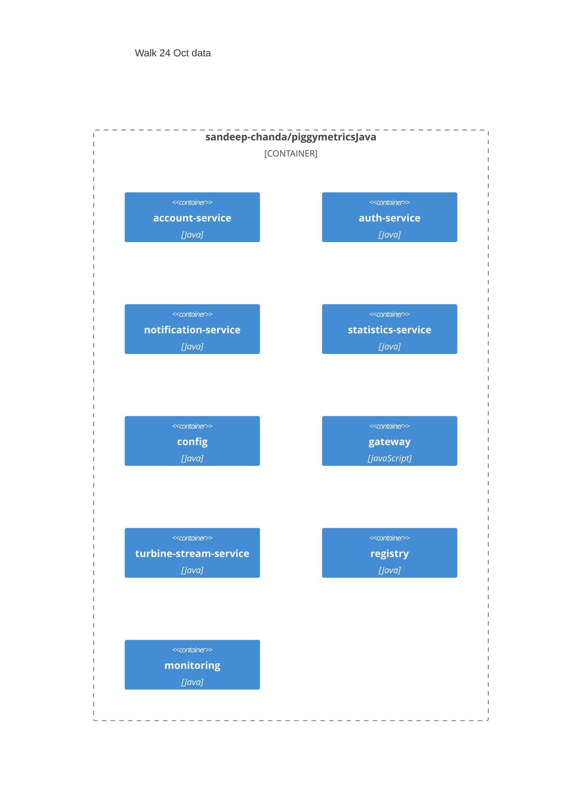
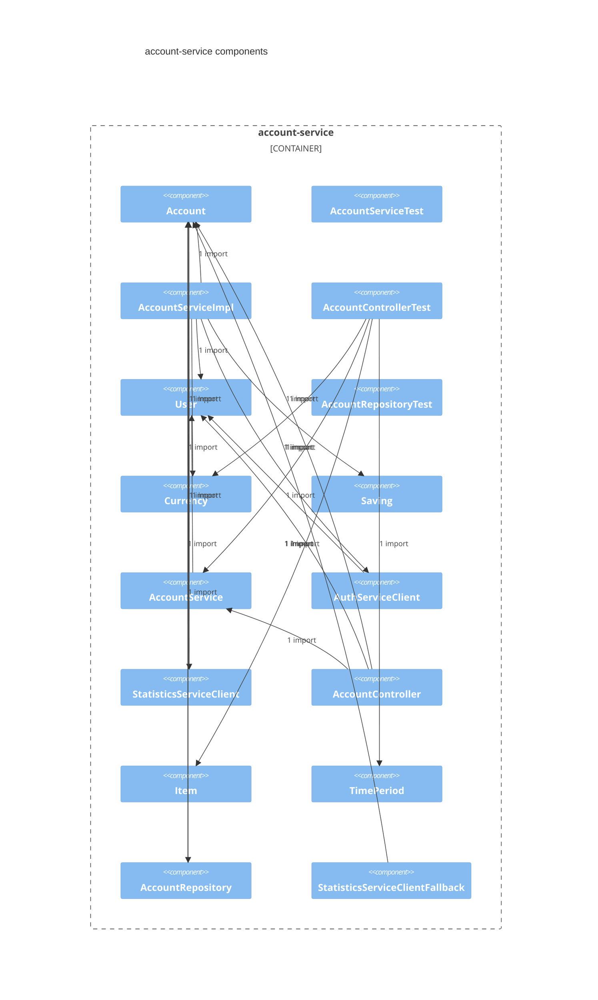
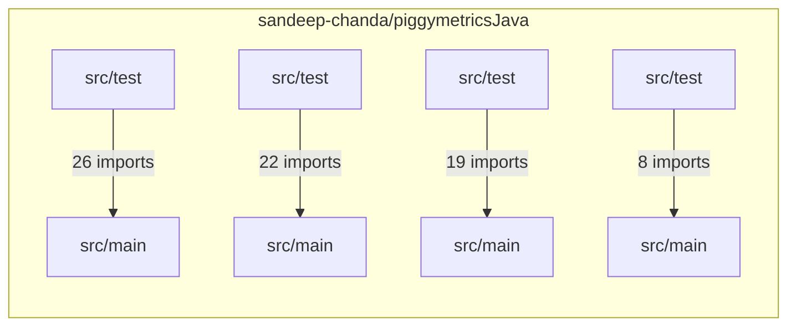

# Walk 24 Oct data

## Intent
Redesign the data pipeline that sandeep-chanda/piggymetricsJava writes, in place.

## Summary
Redesign the data pipeline that sandeep-chanda/piggymetricsJava writes, in place.

## Scope
- Covers sandeep-chanda/piggymetricsJava; refine before approve.

## Acceptance criteria
- sandeep-chanda/piggymetricsJava contains the new behaviour and its indexed tests pass

## Architecture
**Container view**




**Component view**




**Module dependencies**



- account-service (Java)
- auth-service (Java)
- notification-service (Java)
- statistics-service (Java)
- config (Java)
- gateway (JavaScript)
- turbine-stream-service (Java)
- registry (Java)
- monitoring (Java)

## Decisions
```decision
chosen: mode: modernization · chosen | stated on the spec (D23) — never inferred from the estate's shape
chosen: target adapter: databricks / file format: delta · chosen | stated on the spec (D14) — never inferred from a platform name the index happens to mention
```

## Phases
- Baseline and contract.
  - Do: trace the existing write path from the Maven modules and deployed topology represented by `pom.xml`, `account-service/pom.xml`, and `docker-compose.yml`, then have the author document the missing design intent, data contract, invariants, and rollback criteria
  - Done when: the current write behavior and target contract are reviewed and reproducible
- In-place pipeline change.
  - Do: implement the redesigned writes behind a reversible compatibility boundary, preserve existing consumers, and add automated coverage for successful writes, retries, duplicate handling, and failures
  - Done when: old and new behavior pass the agreed contract and recovery tests without requiring an unverified parallel pipeline
- Deployment and cutover.
  - Do: update the deployed surface in `docker-compose.dev.yml` and `docker-compose.yml`, run the repository’s Travis validation, and cut over with rollback criteria and write-result monitoring
  - Done when: the deployed pipeline meets the acceptance contract and rollback has been exercised

## Impacted assets
- {'repo_slug': 'sandeep-chanda/piggymetricsJava'}

## Related work
- Walk 24 Oct new feature v1 (approved) — spec already covering this
- Walk 24 Oct enhancement v1 (approved) — spec already covering this
- Walk 24 Oct modernization v1 (approved) — spec already covering this
- Walk 24 Oct migration v1 (published) — spec already covering this
- Walk 22 Oct redeploy v1 (published) — spec already covering this

## Change plan
- Discovery — Do: identify the current write-path objects, schemas, ownership boundaries, and compatibility requirements; the indexed evidence does not expose the implementation files or an architecture decision record. Done when: the author has approved a source-to-sink map and invariants for the in-place redesign.
- Build — Do: modify the identified write-path objects and update the root and affected service Maven configuration only where the redesign requires dependency or module changes. Done when: old and new data contracts are covered by automated tests and all affected Maven modules build successfully.
- Deployment — Do: update the development and production Docker Compose objects for any changed runtime configuration, storage, or service wiring while preserving an in-place upgrade path. Done when: both composed environments start successfully and a rollback rehearsal restores the prior write behavior.
- Verification — Do: extend the Travis CI object to exercise migration, compatibility, failure recovery, and data-integrity checks. Done when: CI passes and reconciliation shows no lost, duplicated, or malformed writes.

## Test plan
First document the current writer’s input, persisted output, ordering, retry, and failure contracts, because the indexed evidence does not expose those pipeline semantics. Add focused unit and integration tests in the affected Maven module, then run the repository-level Maven verification to catch cross-module regressions. Exercise the redesigned flow through both docker-compose.yml and docker-compose.dev.yml, verifying successful writes, malformed input, dependency unavailability, retries, duplicate handling, and restart recovery. Finally, run the existing Travis CI configuration and require all prior tests plus the new pipeline tests to pass before rollout.

## Rollout
The evidence identifies container definitions and CI configuration, but does not identify the specific writer, endpoint, datastore migration, or deployment mechanism beyond those files.
- Discovery — Do: confirm the owning service, write contract, compatibility requirements, and rollback signal with the author; Done when: the current and target data paths are documented and testable.
- Development rollout — Do: implement the backward-compatible change and validate it through `docker-compose.dev.yml`; Done when: old and new data handling pass integration and failure-path tests in the development stack.
- Deployed rollout — Do: update `docker-compose.yml`, run the checks configured through `.travis.yml`, then replace the affected deployed service while retaining a reversible compatibility path; Done when: deployed writes and reads are verified and rollback is no longer required.

## Rollback
Undo the redesign by redeploying the last known-good application images with the previous docker-compose.yml or docker-compose.dev.yml definitions, while keeping the new pipeline disabled. Before rollout, record immutable image identifiers and take a restorable data snapshot; rollback is complete when the prior services pass smoke checks and data integrity checks against that snapshot. The indexed evidence does not document image-version pinning, database backup/restore commands, or an automated rollback job, so these must be added and rehearsed rather than assumed from the existing Travis configuration.

## Risk
The in-place pipeline redesign could introduce incompatible data or configuration changes across independently packaged Maven services, since account, authentication, notification, gateway, configuration, monitoring, and registry components have separate build descriptors. Deployment drift is also a risk because both development and non-development Docker Compose definitions must remain aligned with the redesigned runtime topology. No architecture or decision record is shown in the evidence, so intended ownership, compatibility guarantees, migration sequencing, and rollback criteria remain unspecified; the visible Travis CI configuration may also require updates, but the evidence does not establish what pipeline checks it performs.

## Estimate
Estimate: large, because an in-place pipeline redesign spans the multi-module Maven build and both development and deployed Docker Compose surfaces. The estimate rests on the root and service-level POMs plus the container definitions, while the evidence does not expose the pipeline-writing implementation well enough for a file-level estimate. The unhelped portion cannot be stated as N of M pipeline-write units: neither the total writer units nor their harness coverage is shown, and the indexed harness README provides no evidenced mapping between helpers and pipeline paths.

## Todo
- [ ] Confirm scope and impacted assets
- [ ] Fill rollout and rollback
- [ ] Record the design — sandeep-chanda/piggymetricsJava has no architecture document indexed
- [ ] Extend sandeep-chanda/piggymetricsJava
- [ ] Review sandeep-chanda/piggymetricsJava

## Plans
### P1 · Baseline and contract.
the current write behavior and target contract are reviewed and reproducible

1. trace the existing write path from the Maven modules and deployed topology represented by `pom.xml`, `account-service/pom.xml`, and `docker-compose.yml`, then have the author document the missing design intent, data contract, invariants, and rollback criteria

### P2 · In-place pipeline change.
old and new behavior pass the agreed contract and recovery tests without requiring an unverified parallel pipeline

1. implement the redesigned writes behind a reversible compatibility boundary, preserve existing consumers, and add automated coverage for successful writes, retries, duplicate handling, and failures

### P3 · Deployment and cutover.
the deployed pipeline meets the acceptance contract and rollback has been exercised

1. update the deployed surface in `docker-compose.dev.yml` and `docker-compose.yml`, run the repository’s Travis validation, and cut over with rollback criteria and write-result monitoring

## Citations
[^1]: sandeep-chanda/piggymetricsJava · README.md
[^2]: sandeep-chanda/piggymetricsJava · .harnessmatters/README.md
[^3]: sandeep-chanda/piggymetricsJava · account-service/pom.xml
[^4]: sandeep-chanda/piggymetricsJava · auth-service/pom.xml
[^5]: sandeep-chanda/piggymetricsJava · pom.xml
[^6]: sandeep-chanda/piggymetricsJava · .travis.yml
[^7]: sandeep-chanda/piggymetricsJava · config/pom.xml
[^8]: sandeep-chanda/piggymetricsJava · docker-compose.dev.yml
[^9]: sandeep-chanda/piggymetricsJava · docker-compose.yml
[^10]: sandeep-chanda/piggymetricsJava · gateway/pom.xml
[^11]: sandeep-chanda/piggymetricsJava · monitoring/pom.xml
[^12]: sandeep-chanda/piggymetricsJava · notification-service/pom.xml
[^13]: sandeep-chanda/piggymetricsJava · .harnessmatters/context/binding.json
[^14]: sandeep-chanda/piggymetricsJava · .harnessmatters/AGENTS.md
[^15]: sandeep-chanda/piggymetricsJava · AGENTS.md
[^16]: sandeep-chanda/piggymetricsJava · .harnessmatters/project.json
[^17]: sandeep-chanda/piggymetricsJava · AGENTS.md
[^18]: sandeep-chanda/piggymetricsJava · .harnessmatters/README.md
[^19]: sandeep-chanda/piggymetricsJava · config/src/main/resources/application.yml
[^20]: sandeep-chanda/piggymetricsJava · turbine-stream-service/src/test/resources/bootstrap.yml
[^21]: spec:e3050599-01d0-4739-8cf5-eb6aa98e04b6
[^22]: spec:b867748c-f6f6-4cc5-9e41-9ee7a3833ab1
[^23]: spec:4d5aa0b9-8267-48e1-b10d-411e33c9195c
[^24]: spec:d3ff8dfe-7a69-4ee8-9fc7-49023382e4f3
[^25]: spec:7bbc7781-4a77-4215-92b2-fee15b030d18
